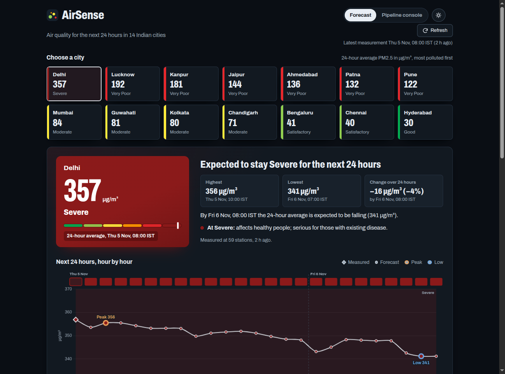
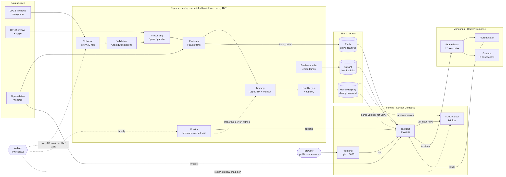

# AirSense

**24-hour PM2.5 forecasts for 14 Indian cities, with the reasons behind each forecast
and health advice: built and operated as an end-to-end AIOps system.**

AirSense collects the official CPCB air-quality feed every 30 minutes, forecasts the
24-hour average PM2.5 for each of the next 24 hours, explains what drives the
forecast, and tells people what to do about it (for the general public, sensitive
groups and outdoor workers). Behind the web page, the whole life cycle is automated:
versioned data, validated pipelines, tracked experiments, a quality gate and a model
registry, containers, scheduled workflows, monitoring with alerts, drift detection
and automatic retraining.

DA3408 course project · Sri Harsha (DA24B034) · November 2026



---

## Architecture



- **Pipeline** (on the laptop, run by DVC, scheduled by Airflow): collect → validate
  → process (Spark for the 14-year history) → features (Feast) → train (LightGBM,
  MLflow) → quality gate → registry.
- **Serving** (Docker Compose): nginx serves the pages and forwards `/api` to a
  FastAPI backend, which reads live features from Redis, calls the MLflow model
  server, explains the forecast with SHAP and finds advice in Qdrant.
- **Monitoring** (Docker Compose + an hourly workflow): Prometheus, Alertmanager and
  Grafana watch the service, the live data and the model; every served forecast is
  compared with what was measured; drift in the inputs or a high error starts a
  retrain by itself.

Details: [docs/architecture.md](docs/architecture.md).

## AIOps practices, and where they are

| Practice | Tool | Where |
|---|---|---|
| Data and model versioning | DVC (15-stage pipeline, local remote) | `dvc.yaml`, `dvc.lock`, `data/**/*.dvc` |
| Data validation | Great Expectations, Python checks | `src/airsense/validation/` |
| Large-scale processing | PySpark | `src/airsense/processing/process_history.py` |
| Feature store | Feast (DuckDB offline, Redis online) | `feature_repo/`, `src/airsense/features/` |
| Experiment tracking, model registry | MLflow (champion / challenger) | `src/airsense/training/` |
| Quality gate | five checks against baselines | `src/airsense/training/gate.py`, `params.yaml` |
| Explainability | SHAP (LightGBM contributions) | `src/airsense/serving/explain.py` |
| Retrieval for advice | sentence-transformers + Qdrant | `src/airsense/guidance/`, `guidance_docs/` |
| Tests and pre-commit | pytest (162 tests), ruff, promtool | `tests/`, `.githooks/pre-commit` |
| Packaging and serving | Docker Compose (8 containers), FastAPI, MLflow model server, nginx; MLflow Project for identical environments | `docker-compose.yml`, `docker/`, `backend/`, `MLproject` |
| Orchestration | Apache Airflow 3.3 (4 workflows) | `airflow/dags/` |
| Monitoring and alerting | Prometheus (13 alert rules), Alertmanager, Grafana | `docker/monitoring/`, `src/airsense/serving/metrics.py` |
| Model monitoring | forecast vs actual, drift (PSI), automatic retrain | `src/airsense/monitoring/`, `airflow/dags/airsense_monitor.py` |
| Operator console | Pipeline console with five tabs | `frontend/pipeline.html` |

## Repository layout

| Folder | Contents |
|---|---|
| `src/airsense/` | the Python package: ingestion, validation, processing, features, training, serving, guidance, monitoring (and `common` for settings) |
| `backend/` | FastAPI application (`main.py`) |
| `frontend/` | Forecast page and Pipeline console (HTML, CSS, JavaScript, Chart.js) |
| `model_server/` | start script for the MLflow model server |
| `feature_repo/` | Feast feature definitions and store settings |
| `airflow/` | the four workflows (`dags/`) and the scripts that start Airflow |
| `docker/` | Dockerfiles, nginx, Prometheus, Alertmanager and Grafana configuration |
| `guidance_docs/` | health advice per AQI category and group (with sources) |
| `tests/` | unit tests (`unit/`) and alert-rule tests (`monitoring/`) |
| `notebooks/` | exploratory analysis: EDA, live-feed checks, the 24-hour average experiment |
| `docs/` | architecture, low-level design, user manual, data sources, features, UI checklist |
| `data/`, `models/`, `reports/` | data, model and plots made by the pipeline, versioned with DVC; Git holds only the `.dvc` files, `dvc.lock` and the small metric files in `data/interim/` |

Top-level files: `dvc.yaml` (the pipeline), `params.yaml` (every setting),
`docker-compose.yml`, `MLproject` and `python_env.yaml` (MLflow Project), `pyproject.toml`, and `requirements.txt` (laptop),
`requirements-serve.txt` (containers), `requirements-dev.txt` (notebooks).
Created when the system runs and kept out of Git: `logs/` (collector, Airflow
runs, alerts), `mlruns/` and `mlflow.db` (MLflow), `feature_repo/data/` (Feast registry).

## Quick start

Set up once on a new machine, in this order. **Every command runs in a terminal at the
root of the repository** (the folder with `dvc.yaml` and `docker-compose.yml`), with
the project environment active (`source .venv/bin/activate`), unless the step says
otherwise.

**Needs** (tested on Ubuntu 26.04 with OpenJDK 17): Linux with about 15 GB free disk;
Python 3.12; Java 17 for Spark (`sudo apt install openjdk-17-jre-headless`); Docker with the Compose
plugin; a free [data.gov.in](https://data.gov.in) API key; a Kaggle account with an API
token in `~/.kaggle/kaggle.json` (Kaggle → Settings → API → Create New Token, then
`chmod 600 ~/.kaggle/kaggle.json`).

**1. Get the code** (in the folder where the project should live)

```bash
git clone <repository URL> airsense && cd airsense
```
Downloads the repository and enters its root; all later steps run from here.

**2. Create the Python environment** (≈ 5 min)

```bash
python3.12 -m venv .venv && source .venv/bin/activate
pip install -r requirements.txt --extra-index-url https://download.pytorch.org/whl/cpu
pip install -e .
git config core.hooksPath .githooks
```
Creates an isolated environment in `.venv` with the exact tested versions; the extra
index provides the CPU-only PyTorch (no GPU needed). `pip install -e .` makes the
`airsense` package importable by the pipeline, the tests and Airflow.
`core.hooksPath` turns on the pre-commit checks (lint, format, quick tests).

**3. Add your keys** (≈ 1 min)

```bash
cp .env.example .env
nano .env        # fill in DATA_GOV_IN_API_KEY and GRAFANA_ADMIN_PASSWORD
```
`.env` holds the secrets and is never committed (it is in `.gitignore`).

**4. Download the history and a first live snapshot** (≈ 5 min)

```bash
kaggle datasets download -d abhisheksjha/time-series-air-quality-data-of-india-2010-2023 \
    -p data/raw/cpcb --unzip
python src/airsense/ingestion/datagov_client.py
```
The first command puts the CPCB station history (2010–2023, 1.6 GB) in
`data/raw/cpcb/`. The second saves one snapshot of the live CPCB feed in
`data/raw/live/datagov/`; the pipeline needs at least one, and Airflow collects the
rest every 30 minutes.

**5. Build the data and the model** (≈ 20–30 min the first time)

```bash
docker compose up -d redis qdrant
dvc repro
```
Starts the two stores the pipeline writes to (Redis: online features; Qdrant: the
health advice), then runs all 15 pipeline steps in order: validate, process (Spark),
weather, features, training table, train, quality gate, register the champion model,
online features, advice index. When it finishes without an error, `dvc status`
lists only the steps that run every time.

**6. Start the web service and monitoring** (≈ 8 min the first time, ≈ 1 min later)

```bash
mkdir -p logs/alerts
AIRSENSE_TAG=$(git rev-parse --short HEAD) docker compose up -d --build
docker compose ps
```
Builds the application images (tagged with the Git commit) and starts all 8
containers: web page (nginx), backend, model server, Redis, Qdrant, Prometheus,
Alertmanager, Grafana. `docker compose ps` should show all of them `healthy` after
about a minute. `logs/alerts` is where the backend keeps the alerts.

**7. Start the scheduler** (in its **own terminal**, kept open)

Once, install Airflow in its own environment (outside the project, so its packages
cannot change the tested ones; needs [uv](https://docs.astral.sh/uv/), `pip install uv`):

```bash
uv venv ~/airflow-venv --python 3.12
uv pip install --python ~/airflow-venv/bin/python "apache-airflow==3.3.2" \
  --constraint "https://raw.githubusercontent.com/apache/airflow/constraints-3.3.2/constraints-3.12.txt"
```

Then, every time (from the repository root):

```bash
bash airflow/start.sh
```
Starts Airflow at http://localhost:8081 (user `admin`; the password is printed in this
terminal at the first start and kept in `~/airflow-airsense/`). In the Airflow UI switch on the four workflows (toggle next to each name):
collection every 30 min, monitoring hourly, retraining weekly, housekeeping daily.
Closing this terminal stops Airflow.

**8. Open the system**

| Open | Address |
|---|---|
| Forecast page | http://localhost:8080 |
| Pipeline console | http://localhost:8080/pipeline.html |
| API documentation | http://127.0.0.1:8000/docs |
| Airflow | http://localhost:8081 |
| Grafana / Prometheus / Alertmanager | http://localhost:3000 / :9090 / :9093 |

**Later, every day:** `docker compose up -d` (if the containers are not running) and
`bash airflow/start.sh` in its own terminal; the rest is automatic. To stop:
`docker compose down` (data is kept) and Ctrl+C in the Airflow terminal.
Operation, failure handling and recovery: [docs/architecture.md](docs/architecture.md)
§7–8 and the [user manual](docs/user_manual.md).

## Tests

```bash
pytest -m "not spark"          # 153 quick tests (also run by the pre-commit hook)
pytest -m spark                # 9 tests with a local Spark session
MLFLOW_TRACKING_URI=sqlite:///mlflow.db mlflow run . -e tests --env-manager local   # as an MLflow Project
docker run --rm -v "$PWD":/w -w /w --entrypoint promtool prom/prometheus:v3.5.0 \
    test rules tests/monitoring/alert_rules_test.yml   # alert rules, 7 scenarios
```

Test plan, test cases and results: [docs/test_plan.md](docs/test_plan.md); manual checks of both web pages: [docs/ui_test_checklist.md](docs/ui_test_checklist.md).
Failure tests (each container stopped, alerts, automatic retraining):
[docs/architecture.md](docs/architecture.md) §7.

## Results

| | Value |
|---|---|
| Training data | 14.3 million rows (city × hour × 24 horizons), 2018–2023, 40 inputs |
| Test error (Oct 2022 – Mar 2023) | MAE **6.80 µg/m³**, against 8.59 for "no change": **21 %** better |
| AQI category right | about 83 % of test forecasts |
| Live check (3 days to 5 November 2026) | model 9.8 vs "no change" 11.1 µg/m³ over 1,106 forecast/actual pairs (11 % better) |
| Failure tests | model server, backend and Airflow outages each raised the right alert and recovered; drift started a retrain without a person |

## Documentation

| Document | Contents |
|---|---|
| [docs/architecture.md](docs/architecture.md) | components, data flow, deployment, workflows, monitoring, failure behaviour, running it, limitations |
| [docs/hld.md](docs/hld.md) | design choices: what was chosen, the alternatives and why |
| [docs/lld.md](docs/lld.md) | API contract, request flow, model input contract, error handling, metrics, configuration, tests |
| [docs/user_manual.md](docs/user_manual.md) | how to use the Forecast page and the Pipeline console; what to do when an alert fires |
| [docs/data_sources.md](docs/data_sources.md) | sources, formats, licences, processed outputs |
| [docs/features.md](docs/features.md) | every model input and how it is computed |
| [docs/test_plan.md](docs/test_plan.md) | test plan: levels, tools, pass criteria; all test cases and the results of the test round |
| [docs/ui_test_checklist.md](docs/ui_test_checklist.md) | manual checks of the web pages, with results |

## Limitations

- **Collection only while the laptop runs** (cloud services were not allowed): hours
  when it is off are missing for good, because the live feed has no history.
- **Single machine:** no replication; the DVC backup is on the same disk; Grafana and
  Prometheus are local to the laptop; alerts go to the console only.
- **Little live data in training so far:** retrained models have not yet beaten the
  first model by the required 1 %.

Possible extensions: e-mail alerts, starting Airflow with the laptop, a map view.

## Data and licences

- Historical PM2.5: CPCB (cpcb.nic.in), via the Kaggle dataset
  *Time Series Air Quality Data of India (2010–2023)*, **CC BY-NC-SA 4.0**; not
  stored in this repository (DVC only).
- Live PM2.5: CPCB real-time feed on data.gov.in, Government Open Data License – India.
- Weather: [Open-Meteo.com](https://open-meteo.com), **CC BY 4.0**.
- Chart.js (MIT), included in `frontend/vendor/`.

Full attribution: [docs/data_sources.md](docs/data_sources.md).
