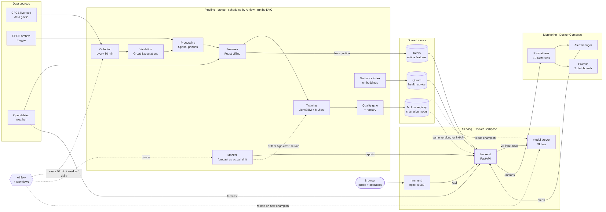
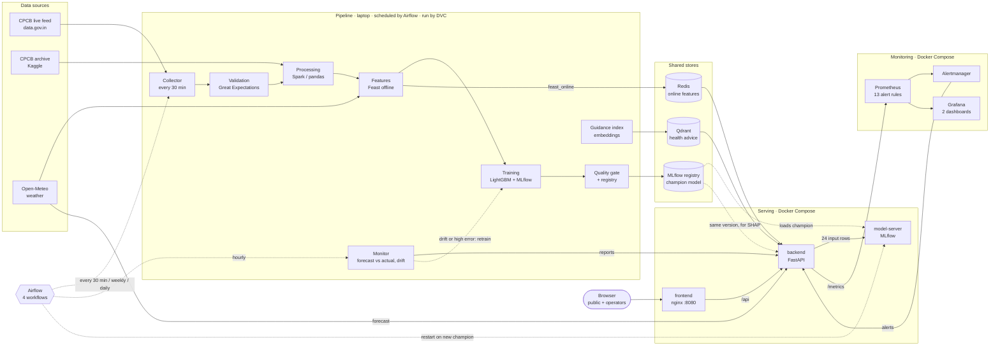

# AirSense — Architecture

AirSense forecasts PM2.5 (24-hour average, µg/m³) for the next 24 hours in 14 Indian
cities and tells people what to do about it. This document shows the system as a
whole: its parts, how data moves through them, how they are deployed, and how to run
and operate it. The details of the serving code (API contract, request flow, model
input contract) are in `docs/lld.md`; data sources and features in
`docs/data_sources.md` and `docs/features.md`; how to use the web pages in
`docs/user_manual.md`. Monitoring (Stage 10) is in §6.

---

## 1. Overview



The diagram source (Mermaid) is in §10; `docs/images/architecture.png` is rendered
from it.

The system has two halves that meet only through files and stores, and a monitoring
layer that watches both:

| Half | Runs | What it does | Output |
|---|---|---|---|
| **Pipeline** (offline) | on the laptop, in the project's Python environment; **Airflow** schedules it (four workflows), **DVC** decides what actually needs re-running | collects live measurements, validates and processes data, builds features, trains, checks and registers the model, builds the guidance index | data and feature files, the registered **champion** model, the online features (Redis), the guidance collection (Qdrant) |
| **Serving** (online) | five Docker containers | answers users: the latest values, a 24-hour forecast, why, and what to do | the web pages and the REST API |
| **Monitoring** | three Docker containers (Prometheus, Alertmanager, Grafana) and the hourly `airsense_monitor` workflow | measures the service, the live data and the model; compares every forecast with what was measured; checks the inputs for drift; raises alerts; starts a retrain when the model needs one | metrics, alerts, dashboards, and the Monitoring tab of the Pipeline console |

The serving system never trains or rewrites data; the pipeline never answers users.
A new model or new features reach users without changing serving code. Since Stage 9
nothing has to be started by hand: Airflow collects every 30 minutes, refreshes the
live features, retrains weekly and serves a new champion, and versions the data daily
(§5). Since Stage 10 the system also checks itself: it raises alerts when a part
fails or the data stops, and retrains on its own when the forecasts get worse or the
inputs drift (§6).

---

## 2. Components

| Component | Technology | Role |
|---|---|---|
| Live collector | Python (`datagov_client.py`), every 30 min | Saves the CPCB real-time feed (data.gov.in) as one CSV per run (run by Airflow; until Stage 9 by cron) |
| Data validation | Great Expectations, Python checks | Rejects broken raw data, checks processed data and weather |
| Processing | PySpark (history), pandas (live) | Station → city hourly values, 24-hour averages |
| Features | pandas, **Feast** | Lags, changes, rolling values, calendar and weather features; offline (Parquet, DuckDB) and online (Redis) |
| Training | LightGBM, **MLflow** tracking | Trains the model, logs parameters, metrics and the model |
| Quality gate | Python | Five checks against baselines before a model may serve |
| Registry | MLflow Model Registry | Versions; the `champion` alias marks the model that serves |
| Guidance index | sentence-transformers, **Qdrant** | Health advice per AQI category and user group, found by semantic search |
| Pipeline control | **DVC** (`dvc.yaml`, 15 stages) | Runs only what changed; versions data and models by checksum; live snapshots and saved forecasts versioned daily (`dvc add` + `dvc push`) |
| Orchestration | **Apache Airflow 3.3** (own environment, `airflow standalone`) | Schedules the pipeline as four workflows (DAGs), with retries, logs and a web UI on port 8081 |
| Model server | `mlflow models serve` | Serves the champion over REST (`/invocations`) |
| Backend | FastAPI | The application: freshness check, weather, model input, AQI, explanation (SHAP), guidance, pipeline status |
| Frontend | HTML, CSS, JavaScript, Chart.js, nginx | Forecast page for the public, Pipeline console for operators |
| Metrics | `prometheus-client` in the backend (`GET /metrics`) | Requests, errors and response times; dependency health, data age, collector state; forecast error, drift (read from the monitor's reports) |
| Prometheus | **Prometheus 3.5** | Reads `/metrics` every 30 s, keeps 15 days, evaluates 13 alert rules |
| Alertmanager | **Alertmanager 0.28** | Groups and forwards alerts to the backend (`POST /alerts`), which keeps them for the console |
| Dashboards | **Grafana 12** | Two dashboards (service; data and model), provisioned from files; four panels embedded in the console |
| Model monitoring | Python, `airsense_monitor` workflow | Saves every served forecast, compares it 24 h later with the measurement and with "no change", checks drift (PSI) daily, decides on an automatic retrain |

---

## 3. How data moves

**Pipeline (offline), in `dvc.yaml` order:**

1. Airflow's `airsense_live` workflow runs the collector every 30 minutes; it saves
   `data/raw/live/datagov/<UTC date>/<HHMM>.csv`.
   History comes from the CPCB archive (Kaggle) in `data/raw/cpcb/`; past weather from
   Open-Meteo.
2. `validate_raw` → `process_history` and `process_live` → `validate_processed`:
   checked city-hourly tables in `data/processed/`.
3. `fetch_weather` → `validate_weather` → `build_features_history` /
   `build_features_live`: feature tables in `data/features/`.
4. `build_training` (history) and `build_training_live` (the hours collected live,
   built with the same code) → `train` → `gate` → `register`: the model in MLflow; if
   it passes the gate and beats the current champion, it becomes the new champion.
   Live rows only join the training rows (with extra weight); validation and test stay
   the same 2022 periods, so models are always compared on the same data.
5. `feast_online` writes the newest features of each city to **Redis** (every 30
   minutes, by `airsense_live`); `guidance_index` embeds the advice texts into
   **Qdrant**.

**Serving (online), one forecast request:**

1. The browser asks nginx for `/api/forecast/Delhi?group=general`; nginx forwards it to
   the backend.
2. The backend reads Delhi's newest features from Redis and refuses to forecast if the
   newest measurement is older than 4 hours.
3. It adds the weather forecast (Open-Meteo, cached 30 min; a saved forecast if the
   service is down) and builds 24 input rows exactly as training did.
4. The model server predicts the 24 hours; the backend converts them to levels and AQI
   categories, explains the forecast with SHAP from the same model version, and finds
   the matching advice in Qdrant.
5. One JSON answer goes back to the page, which draws it.

**Monitoring, every hour (`airsense_monitor`, details in §6):**

1. Save every city's forecast as the backend serves it (`data/monitoring/forecasts/`).
2. Compare the saved forecasts whose hour has passed with the measured values, for the
   model and for "no change" (`evaluation.json`).
3. Once a day (22:50 IST), compare the last 7 days of live inputs with the training
   data of the same months (`drift.json`).
4. Decide whether to retrain (`retrain_decision.json`) and, if so, start
   `airsense_retrain`.
5. The backend turns these reports into metrics; Prometheus reads them with the
   service metrics and raises alerts.

---

## 4. Deployment

```
Laptop (Ubuntu, CPU only)
│
├── Project folder ~/projects/airsense  (Git + DVC)
│     pipeline code, data, mlruns/ + mlflow.db (models), feature_repo/ (Feast),
│     airflow/dags/ (the four workflows)
│     └── Python environment (.venv): DVC pipeline, collector, tests
│
├── Airflow 3.3  (own environment ~/airflow-venv; files in ~/airflow-airsense)
│     airflow standalone: scheduler, DAG processor, triggerer, web UI 127.0.0.1:8081
│     tasks run the pipeline in the project's .venv  (bash airflow/start.sh)
│
└── Docker Compose project "airsense"  (one private network)
      frontend      nginx              0.0.0.0:8080   ← the only public port
      backend       FastAPI (uvicorn)  127.0.0.1:8000 (API docs, debugging)
      model-server  MLflow             internal only
      redis         Feast online store 127.0.0.1:6379 (filled by the pipeline)
      qdrant        guidance index     127.0.0.1:6333 (filled by the pipeline)
      prometheus    metrics, alerts    127.0.0.1:9090
      alertmanager  alert routing      127.0.0.1:9093
      grafana       dashboards         127.0.0.1:3000
```

| Container | Image | Memory limit | Health check |
|---|---|---|---|
| frontend | `airsense-frontend:<commit>` (nginx-unprivileged 1.27) | 64 MB | page loads |
| backend | `airsense-app:<commit>` | 3 GB | `GET /health` answers |
| model-server | `airsense-app:<commit>` (same image, other command) | 1.5 GB | `GET /ping` |
| redis | `redis:7.4.2-alpine` | 256 MB | `redis-cli ping` |
| qdrant | `qdrant/qdrant:v1.19.0` | 512 MB | port 6333 open |
| prometheus | `prom/prometheus:v3.5.0` | 256 MB | `/-/healthy` |
| alertmanager | `prom/alertmanager:v0.28.1` | 64 MB | `/-/healthy` |
| grafana | `grafana/grafana:12.0.0` | 256 MB | `/api/health` |

**Design decisions**

- **Loosely coupled services.** The backend talks to the model server, Redis and
  Qdrant only over the network, by name (`http://model-server:5002`, `redis:6379`,
  `http://qdrant:6333`). Each can be restarted or replaced on its own; the backend
  reports which one is missing instead of failing as a whole.
- **One application image, two roles.** Backend and model server need the same
  packages and code, so they share one image; Docker Compose gives each its own
  command, port and memory limit. Images are tagged with the Git commit they were
  built from.
- **Models and data are mounted, not copied.** The project folder is mounted
  **read-only** into both application containers, at the **same absolute path** as on
  the laptop, because the MLflow database and the Feast registry store absolute paths.
  A newly registered champion is served after a restart; no image rebuild. The
  backend writes only to the saved weather forecasts and the received alerts
  (`logs/alerts/`). For `dvc status` (console) it has its **own** DVC scratch folder in
  memory (`tmpfs`), not the laptop's `.dvc/tmp`: inside a container the laptop's
  process IDs do not exist, so a shared one let the console's `dvc status` remove the
  lock of a running `dvc repro` as if that process had died. Models are loaded from a temporary copy
  inside the container, since MLflow writes a small file next to a model it loads.
- **Only the frontend is public.** nginx serves the pages and forwards `/api/` to the
  backend, so the browser talks to one address; it does not forward `/api/metrics` or
  `/api/alerts` (internal). The model server has no published port; Redis and Qdrant
  are reachable from the laptop only, so the pipeline can fill them. Prometheus,
  Alertmanager and Grafana are local to the laptop too; Grafana viewers need no login
  (read-only), its admin password is in `.env`.
- **The pipeline stays outside the containers.** It needs Spark, the full data and the
  laptop's environment. Airflow (Stage 9) schedules it from its own environment:
  Airflow's pinned packages (FastAPI, pydantic, alembic, grpcio, …) differ from the
  pipeline's, so installing it into `.venv` would have changed 16 of the pipeline's
  tested packages; its tasks call the project's `.venv` instead.
- **Safe by default.** Containers run as a normal user (uid 1000, not root); secrets
  (`.env`) are never copied into an image (`.dockerignore`); every container restarts
  by itself after a crash (`restart: unless-stopped`) and starts only when what it
  needs is healthy.

---

## 5. Scheduled workflows (Airflow)

Four DAGs in `airflow/dags/`. Every pipeline step is one task running
`dvc repro -s <stage>` in the project folder with `.venv` activated: DVC still decides
whether anything changed and keeps `dvc.lock` correct; Airflow adds the schedule, the
order, retries, logs and the graph. All DVC tasks share a pool with **one slot**,
because DVC locks the repository (two DVC commands at once would fail).

| Workflow | Schedule | Tasks | Notes |
|---|---|---|---|
| `airsense_live` | every 30 min, at :05 and :35 | `collect` → `process_live` → `validate_processed` → `build_features_live` → `feast_online` | replaced the collector's cron job; `validate_processed` is a gate: bad data never reaches Redis; `feast_online` checks online = offline features |
| `airsense_retrain` | Sundays 13:00 IST, started manually, or started by `airsense_monitor` | `champion_before` → `build_training` → `build_training_live` → `train` → `gate` → `register` → `champion_changed` → `restart_serving` | about 5 min with new live data; a failed gate stops the run and the champion keeps serving; the containers are restarted only if the champion changed, then `/health` must report the new version; its DVC steps log in full (`-v`) |
| `airsense_monitor` | every hour at :50 | `record_forecasts` → `evaluate` → (`drift_due` → `check_drift`) → `decide_retrain` → `trigger_retrain` | the drift check runs at 22:50 IST and in manual runs; a retrain is started when the error is high or there is drift, at most every 3 days (§6) |
| `airsense_housekeeping` | daily at 23:15 IST | `version_live_data` → `push_data` → `commit_checkpoint` → `gc_dvc_cache`; `clean_airflow_logs`, `prune_old_images` | live snapshots (CPCB feed, Open-Meteo forecasts) and the saved forecasts cannot be downloaded again: `dvc add` + `dvc push` daily; one Git commit per day ("Daily data checkpoint"), only for data versions and reports; `dvc gc` drops the 30-minute intermediates |

- **Missed runs are not replayed** (`catchup=False`): the feed only has the current
  hour, so a replay would fetch "now" several times. One run at a time per workflow.
- **Failures:** each task retries (training does not: it is memory-heavy); a failed run
  is red in Airflow and on the Pipeline console. A collector run that finds the CPCB
  feed empty ends as "skipped" (exit code 99), shown as "Source empty", not as a
  failure: it is a gap at the source, not in AirSense.
- **Pipeline console:** when a run ends, the DAG writes its result to
  `logs/airflow_runs.json`; the console shows each workflow's latest run with a link to
  Airflow. No Airflow login or network access is needed by the backend.

---

## 6. Monitoring (Stage 10)

**What is measured** (backend `GET /metrics`, read by Prometheus every 30 s):

| Area | Metrics | From |
|---|---|---|
| Service | requests and response time per endpoint and status; forecasts made / unavailable / failed; model-server call time | counted as requests happen |
| Dependencies | model server, live data store (Redis), served model = registry champion | the backend's health check, on each read |
| Live data | age of the newest value per city, cities with data, snapshots in 24 h, minutes since the last one, collector's last result | data files and `logs/collector_status.json` |
| Laptop | free and total space on the disk that holds the project | the mounted project folder |
| Model | forecast error of the model and of "no change" (3 days), skill, pairs, error by hours ahead, "error high"; PSI and level per input | the monitor's reports |

**Model monitoring** (`airsense_monitor`, hourly):

- *Forecast vs actual:* every served forecast is saved; once its hour has passed it is
  compared with the measured 24-hour average. A forecast saved by several runs counts
  once. Over 3 days: the error is **high** when it is above 1.5 × the test error,
  worse than "no change", and based on at least 100 pairs.
- *Drift:* the Population Stability Index (10 bins at the training deciles) of six
  inputs (PM2.5 level and change, temperature, humidity, wind, rain), last 7 days of
  live data against training rows of the **same months** (October–November): every
  season differs from the yearly average. PSI 0.2–0.3 is moderate, above 0.3 drift;
  fewer than 200 live values: "not enough data".
- *When the backend is down:* the forecasts of that hour cannot be saved, but the
  check of the earlier ones, the drift check and the retrain decision still run.
- *Automatic retrain:* when the error is high or there is drift (report at most 26 h
  old) and `monitoring.auto_retrain` is on, `airsense_retrain` is started, at most
  every 3 days. The quality gate and the champion rule still decide whether the new
  model serves.

**Alerts** (`docker/monitoring/alert_rules.yml`, tested with `promtool`):

| Alert | When | Severity |
|---|---|---|
| BackendDown | Prometheus cannot read `/metrics` for 2 min | critical |
| ModelServerDown, LiveDataStoreDown | dependency down for 2 min | critical |
| ServedModelNotChampion | a new champion not served for 30 min | warning |
| HighErrorRate | > 5 % server errors for 5 min | warning |
| SlowForecasts | p95 forecast time > 2 s for 10 min, with ≥ 10 forecasts | warning |
| LiveDataStale | no city has data newer than 4 h, for 15 min | warning |
| CollectorNotRunning | no collector run for 75 min | warning |
| CPCBFeedEmpty | the feed has been empty for over an hour | warning |
| CollectorErrors | the collector failing for 35 min | warning |
| DiskSpaceLow | less than 5 GB free on the laptop's disk for 10 min | warning |
| ForecastErrorHigh | the monitor's "error high" | warning |
| DataDrift | largest PSI > 0.3 | warning |

A down model server or Redis suppresses the error-rate and slow-forecast alerts (they
would only repeat it). Alertmanager waits 30 s before the first message and sends an
update per alert at most every 5 minutes, so a resolved alert reaches the console up
to 5 minutes after it ended: detection is fast, notification is calm, so a flickering
part gives one message, not dozens.

**Where to look:** the console's Monitoring tab (alerts, forecast error, drift,
retrain decisions, four Grafana panels); Grafana (http://localhost:3000) for the full
dashboards; Prometheus (http://localhost:9090/alerts) for the rules' state;
Alertmanager (http://localhost:9093). All three are local to the laptop.

---

## 7. Behaviour when a part fails

Tested by stopping or crashing each part while the pages were open:

| Part down | What the user sees | Recovery |
|---|---|---|
| Model server | "Could not load the forecast … Model server unavailable"; city tiles still work; `/health` names the model server | on restart, without restarting anything else |
| Redis (online features) | within a second: "Live data store unavailable"; `/health` shows the feature store as down | the next request after Redis is back works |
| Qdrant (guidance) | forecast, chart and explanation still shown; advice box says advice is not available | the next request after Qdrant is back |
| Backend crash | a few seconds of "service not running" | Docker restarts it (≈ 6 s), healthy again after ≈ 22 s |
| Backend stopped | red bar at once: the service is not running or not answering; nginx keeps serving the pages | after `docker compose start backend` |
| Whole system (`down` / `up`) | — | features and guidance survive in Docker volumes; no pipeline run needed |
| Disk almost full (seen 5 Nov, about 2 GB free during a rebuild) | the model server could not copy the champion on start-up; `docker compose up` stopped, so backend and frontend were not started (site down) | free space, then `docker compose up -d`; since then the DiskSpaceLow alert warns below 5 GB |

Monitoring, tested on the laptop on 4–5 Nov 2026 (times IST):

| Test | Alert | Fired | Resolved | What the console showed |
|---|---|---|---|---|
| Model server stopped | ModelServerDown | 23:43 | 23:46 (3 min) | Monitoring card red, critical alert with what to check; forecast page "Model server unavailable"; Grafana dependency DOWN |
| Airflow not running (laptop asleep) | CollectorNotRunning | 23:27 (75 min + 5 min after the last run, as the rule says) | 23:45, at the next live run | "Airflow may be stopped" on the Workflows card |
| Backend stopped | BackendDown | 23:54 | 23:56 (2 min) | the console's red banner while it was down (it needs the backend); Alertmanager held the alert and the console listed it as resolved afterwards |
| Drift limit lowered to 0.25 for the test | — (decision, not alert) | 00:05 | — | "Retrain started: data drift in temperature_2m"; `airsense_retrain` started by the monitor (run type "operator triggered"), green in 3 min; v1 kept by the champion rule; next possible after the 3-day cooldown |

---

## 8. Running it

Prerequisites: Docker with the Compose plugin; the project folder with the pipeline
run at least once (`dvc repro`), so a champion model exists. Run every command from
the project root.

**Start or update**

```bash
AIRSENSE_TAG=$(git rev-parse --short HEAD) docker compose up -d --build
docker compose ps                      # wait until all eight are running / healthy (≈ 1 min)
dvc repro feast_online                 # newest features into Redis
dvc repro -f guidance_index            # first start only: advice into Qdrant
```

Open http://localhost:8080 (forecast) and http://localhost:8080/pipeline.html
(console); API documentation at http://127.0.0.1:8000/docs; Grafana at
http://localhost:3000, Prometheus at http://localhost:9090, Alertmanager at
http://localhost:9093. Before the first start: `mkdir -p logs/alerts`, and set
`GRAFANA_ADMIN_PASSWORD` in `.env` (see `.env.example`).

**Start the scheduler** (its own terminal). Airflow is installed once, in its own
environment outside the project:

```bash
uv venv ~/airflow-venv --python 3.12
uv pip install --python ~/airflow-venv/bin/python "apache-airflow==3.3.2" \
  --constraint "https://raw.githubusercontent.com/apache/airflow/constraints-3.3.2/constraints-3.12.txt"
```

Then, each time:

```bash
bash airflow/start.sh                  # Airflow UI at http://localhost:8081 (user admin)
bash airflow/cli.sh dags list-import-errors
```

New workflows start paused: switch each on in the Airflow UI (toggle next to its name).

`--build` is needed only when code, the Dockerfiles or `requirements-serve.txt`
changed. To start the images that already exist without building, give their tag:
`AIRSENSE_TAG=<tag> docker compose up -d` (`docker images` lists the tags).

**Everyday operations**

| Task | Command |
|---|---|
| Status of all containers | `docker compose ps` |
| Logs of one service | `docker compose logs backend --tail 80` (or `model-server`, `frontend`, …) |
| Health of the dependencies | `curl -s 127.0.0.1:8000/health` |
| Refresh live features | automatic every 30 min (`airsense_live`); by hand: Trigger it in Airflow |
| Retrain and serve a better model | automatic on Sundays (`airsense_retrain`); by hand: Trigger it; it restarts the containers only if the champion changed |
| Serve a champion registered outside Airflow | `docker compose restart model-server backend` |
| Back up the live data | automatic daily (`airsense_housekeeping`); by hand: `dvc add data/raw/live/datagov data/raw/live/openmeteo && dvc push` |
| Run any Airflow command | `bash airflow/cli.sh <command>`, e.g. `dags list`, `dags trigger airsense_live` |
| Alerts now | console Monitoring tab, or http://localhost:9090/alerts |
| Test the alert rules | `docker run --rm -v "$PWD":/w -w /w --entrypoint promtool prom/prometheus:v3.5.0 test rules tests/monitoring/alert_rules_test.yml` |
| Free disk space | `df -h /`; `docker system df`; `docker builder prune -f` removes old build layers only (the next build is slower). A rebuild needs about 5 GB free (DiskSpaceLow alert below that) |
| After changing a container's mounts | `docker compose rm -s -f <service> && docker compose up -d <service>` (a plain `up -d` can keep the old mount); check with `docker inspect <container>` |
| Roll back to an earlier model | `python -c "from mlflow import MlflowClient; MlflowClient('sqlite:///mlflow.db').set_registered_model_alias('airsense-pm25', 'champion', '<version>')"`, then `docker compose restart model-server backend` (the registry keeps every version; `data/interim/registry.json` in Git shows which one served at each commit) |
| Run the tests as an MLflow Project | `MLFLOW_TRACKING_URI=sqlite:///mlflow.db mlflow run . -e tests --env-manager local` (`--env-manager virtualenv` builds a fresh environment from `python_env.yaml`) |
| Stop everything (data kept) | `docker compose down` |
| Remove old image versions | `KEEP=$(git rev-parse --short HEAD); docker images --format '{{.Repository}}:{{.Tag}}' \| grep -E '^airsense-(app\|frontend):' \| grep -v ":$KEEP$" \| xargs -r docker rmi` |

Run on the laptop without Docker (development): see `docs/lld.md` §8. A retrain step
that failed after the work was done (for example DVC could not record it) can be
recovered without repeating it: `dvc commit -f <stage>`, mark the task as success in
Airflow, then clear the next task with "Downstream".

**Notes**

- The project folder must not be moved after the model is trained (the stored paths
  would no longer exist); re-run `dvc repro train gate register` after moving it.
- The containers' user has uid 1000; on a machine where the project owner has
  another uid, build with `--build-arg UID=$(id -u)`.
- First build: about 8 minutes and 3.3 GB for the application image (CPU-only
  PyTorch); later builds that change only code take about 1–2 minutes.

---

## 9. Known limitations

- **Collection only while the laptop is on.** The live feed gives only the current
  hour, so hours when the laptop was off or offline are missing for good. Forecasts
  then lack some history inputs (the page lists them under "Notes"). After the laptop
  wakes, a pending run and the current one may both collect (two snapshots a minute
  apart); processing removes the repeated readings.
- **Airflow in standalone mode** (one process, SQLite database): meant for a single
  machine, as here; a server would run its components separately on PostgreSQL.
- **Single machine.** All services run on one laptop; no replication or load balancing.
  The containers make moving to a server a configuration change, not a rewrite.
- **The DVC backup is on the same disk.** `dvc push` copies the data versions to
  `~/dvc-remote` on the laptop: it protects against deleted or broken files, not
  against losing the disk. A second disk would be one more DVC remote; a cloud
  remote is not allowed in this project.
- **Alerts go to the console only.** Alertmanager sends them to the backend; e-mail or
  chat notifications would be one more receiver in `alertmanager.yml`. Grafana and
  Prometheus are visible only on the laptop.
- **Live data in training is still small.** About two weeks with gaps (the laptop was
  off at times), so the live rows carry only a few per cent of the training weight; the
  retrained models have not yet beaten the champion by the required 1 %.

---

## 10. Diagram source


