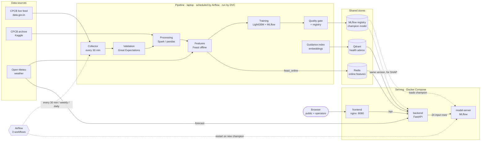

# AirSense — Architecture

AirSense forecasts PM2.5 (24-hour average, µg/m³) for the next 24 hours in 14 Indian
cities and tells people what to do about it. This document shows the system as a
whole: its parts, how data moves through them, how they are deployed, and how to run
and operate it. The details of the serving code (API contract, request flow, model
input contract) are in `docs/lld.md`; data sources and features in
`docs/data_sources.md` and `docs/features.md`; how to use the web pages in
`docs/user_manual.md`.

---

## 1. Overview


The diagram source (Mermaid) is in §9; `docs/images/architecture.png` is rendered
from it.

The system has two halves that meet only through files and stores:

| Half | Runs | What it does | Output |
|---|---|---|---|
| **Pipeline** (offline) | on the laptop, in the project's Python environment; **Airflow** schedules it (three workflows), **DVC** decides what actually needs re-running | collects live measurements, validates and processes data, builds features, trains, checks and registers the model, builds the guidance index | data and feature files, the registered **champion** model, the online features (Redis), the guidance collection (Qdrant) |
| **Serving** (online) | five Docker containers | answers users: the latest values, a 24-hour forecast, why, and what to do | the web pages and the REST API |

The serving system never trains or rewrites data; the pipeline never answers users.
A new model or new features reach users without changing serving code. Since Stage 9
nothing has to be started by hand: Airflow collects every 30 minutes, refreshes the
live features, retrains weekly and serves a new champion, and versions the data daily
(§5).

---

## 2. Components

| Component | Technology | Role |
|---|---|---|
| Live collector | Python (`datagov_client.py`), every 30 min | Saves the CPCB real-time feed (data.gov.in) as one CSV per run (run by Airflow; until Stage 9 by cron) |
| Data validation | Great Expectations, Python checks | Rejects broken raw data, checks processed data and weather |
| Processing | PySpark (history), pandas (live) | Station → city hourly values, 24-hour averages |
| Features | pandas, **Feast** | Lags, changes, rolling values, calendar and weather features; offline (Parquet, DuckDB) and online (Redis) |
| Training | LightGBM, **MLflow** tracking | Trains the model, logs parameters, metrics and the model |
| Quality gate | Python | Five checks against baselines before a model may serve |
| Registry | MLflow Model Registry | Versions; the `champion` alias marks the model that serves |
| Guidance index | sentence-transformers, **Qdrant** | Health advice per AQI category and user group, found by semantic search |
| Pipeline control | **DVC** (`dvc.yaml`, 14 stages) | Runs only what changed; versions data and models by checksum; live snapshots versioned daily (`dvc add` + `dvc push`) |
| Orchestration | **Apache Airflow 3.3** (own environment, `airflow standalone`) | Schedules the pipeline as three workflows (DAGs), with retries, logs and a web UI on port 8081 |
| Model server | `mlflow models serve` | Serves the champion over REST (`/invocations`) |
| Backend | FastAPI | The application: freshness check, weather, model input, AQI, explanation (SHAP), guidance, pipeline status |
| Frontend | HTML, CSS, JavaScript, Chart.js, nginx | Forecast page for the public, Pipeline console for operators |

---

## 3. How data moves

**Pipeline (offline), in `dvc.yaml` order:**

1. Airflow's `airsense_live` workflow runs the collector every 30 minutes; it saves
   `data/raw/live/datagov/<UTC date>/<HHMM>.csv`.
   History comes from the CPCB archive (Kaggle) in `data/raw/cpcb/`; past weather from
   Open-Meteo.
2. `validate_raw` → `process_history` and `process_live` → `validate_processed`:
   checked city-hourly tables in `data/processed/`.
3. `fetch_weather` → `validate_weather` → `build_features_history` /
   `build_features_live`: feature tables in `data/features/`.
4. `build_training` → `train` → `gate` → `register`: the model in MLflow; if it passes
   the gate and beats the current champion, it becomes the new champion.
5. `feast_online` writes the newest features of each city to **Redis** (every 30
   minutes, by `airsense_live`); `guidance_index` embeds the advice texts into
   **Qdrant**.

**Serving (online), one forecast request:**

1. The browser asks nginx for `/api/forecast/Delhi?group=general`; nginx forwards it to
   the backend.
2. The backend reads Delhi's newest features from Redis and refuses to forecast if the
   newest measurement is older than 4 hours.
3. It adds the weather forecast (Open-Meteo, cached 30 min; a saved forecast if the
   service is down) and builds 24 input rows exactly as training did.
4. The model server predicts the 24 hours; the backend converts them to levels and AQI
   categories, explains the forecast with SHAP from the same model version, and finds
   the matching advice in Qdrant.
5. One JSON answer goes back to the page, which draws it.

---

## 4. Deployment

```
Laptop (Ubuntu, CPU only)
│
├── Project folder ~/projects/airsense  (Git + DVC)
│     pipeline code, data, mlruns/ + mlflow.db (models), feature_repo/ (Feast),
│     airflow/dags/ (the three workflows)
│     └── Python environment (.venv): DVC pipeline, collector, tests
│
├── Airflow 3.3  (own environment ~/airflow-venv; files in ~/airflow-airsense)
│     airflow standalone: scheduler, DAG processor, triggerer, web UI 127.0.0.1:8081
│     tasks run the pipeline in the project's .venv  (bash airflow/start.sh)
│
└── Docker Compose project "airsense"  (one private network)
      frontend      nginx              0.0.0.0:8080   ← the only public port
      backend       FastAPI (uvicorn)  127.0.0.1:8000 (API docs, debugging)
      model-server  MLflow             internal only
      redis         Feast online store 127.0.0.1:6379 (filled by the pipeline)
      qdrant        guidance index     127.0.0.1:6333 (filled by the pipeline)
```

| Container | Image | Memory limit | Health check |
|---|---|---|---|
| frontend | `airsense-frontend:<commit>` (nginx-unprivileged 1.27) | 64 MB | page loads |
| backend | `airsense-app:<commit>` | 3 GB | `GET /health` answers |
| model-server | `airsense-app:<commit>` (same image, other command) | 1.5 GB | `GET /ping` |
| redis | `redis:7.4.2-alpine` | 256 MB | `redis-cli ping` |
| qdrant | `qdrant/qdrant:v1.19.0` | 512 MB | port 6333 open |

**Design decisions**

- **Loosely coupled services.** The backend talks to the model server, Redis and
  Qdrant only over the network, by name (`http://model-server:5002`, `redis:6379`,
  `http://qdrant:6333`). Each can be restarted or replaced on its own; the backend
  reports which one is missing instead of failing as a whole.
- **One application image, two roles.** Backend and model server need the same
  packages and code, so they share one image; Docker Compose gives each its own
  command, port and memory limit. Images are tagged with the Git commit they were
  built from.
- **Models and data are mounted, not copied.** The project folder is mounted
  **read-only** into both application containers, at the **same absolute path** as on
  the laptop, because the MLflow database and the Feast registry store absolute paths.
  A newly registered champion is served after a restart; no image rebuild. The
  backend can write to two folders only: DVC's scratch folder (for `dvc status` on the
  console) and the saved weather forecasts. Models are loaded from a temporary copy
  inside the container, since MLflow writes a small file next to a model it loads.
- **Only the frontend is public.** nginx serves the pages and forwards `/api/` to the
  backend, so the browser talks to one address. The model server has no published
  port; Redis and Qdrant are reachable from the laptop only, so the pipeline can fill
  them.
- **The pipeline stays outside the containers.** It needs Spark, the full data and the
  laptop's environment. Airflow (Stage 9) schedules it from its own environment:
  Airflow's pinned packages (FastAPI, pydantic, alembic, grpcio, …) differ from the
  pipeline's, so installing it into `.venv` would have changed 16 of the pipeline's
  tested packages; its tasks call the project's `.venv` instead.
- **Safe by default.** Containers run as a normal user (uid 1000, not root); secrets
  (`.env`) are never copied into an image (`.dockerignore`); every container restarts
  by itself after a crash (`restart: unless-stopped`) and starts only when what it
  needs is healthy.

---

## 5. Scheduled workflows (Airflow)

Three DAGs in `airflow/dags/`. Every pipeline step is one task running
`dvc repro -s <stage>` in the project folder with `.venv` activated: DVC still decides
whether anything changed and keeps `dvc.lock` correct; Airflow adds the schedule, the
order, retries, logs and the graph. All DVC tasks share a pool with **one slot**,
because DVC locks the repository (two DVC commands at once would fail).

| Workflow | Schedule | Tasks | Notes |
|---|---|---|---|
| `airsense_live` | every 30 min, at :05 and :35 | `collect` → `process_live` → `validate_processed` → `build_features_live` → `feast_online` | replaced the collector's cron job; `validate_processed` is a gate: bad data never reaches Redis; `feast_online` checks online = offline features |
| `airsense_retrain` | Sundays 13:00 IST, or started manually | `champion_before` → `build_training` → `train` → `gate` → `register` → `champion_changed` → `restart_serving` | unchanged data: every step is skipped by DVC in seconds; a failed gate stops the run and the champion keeps serving; the containers are restarted only if the champion changed, then `/health` must report the new version |
| `airsense_housekeeping` | daily at 23:15 IST | `version_live_data` → `push_data` → `commit_checkpoint` → `gc_dvc_cache`; `clean_airflow_logs`, `prune_old_images` | live snapshots (CPCB feed, Open-Meteo forecasts) cannot be downloaded again: `dvc add` + `dvc push` daily; one Git commit per day ("Daily data checkpoint"), only for data versions and reports; `dvc gc` drops the 30-minute intermediates |

- **Missed runs are not replayed** (`catchup=False`): the feed only has the current
  hour, so a replay would fetch "now" several times. One run at a time per workflow.
- **Failures:** each task retries (training does not: it is memory-heavy); a failed run
  is red in Airflow and on the Pipeline console.
- **Pipeline console:** when a run ends, the DAG writes its result to
  `logs/airflow_runs.json`; the console shows each workflow's latest run with a link to
  Airflow. No Airflow login or network access is needed by the backend.

---

## 6. Behaviour when a part fails

Tested by stopping or crashing each part while the pages were open:

| Part down | What the user sees | Recovery |
|---|---|---|
| Model server | "Could not load the forecast … Model server unavailable"; city tiles still work; `/health` names the model server | on restart, without restarting anything else |
| Redis (online features) | within a second: "Live data store unavailable"; `/health` shows the feature store as down | the next request after Redis is back works |
| Qdrant (guidance) | forecast, chart and explanation still shown; advice box says advice is not available | the next request after Qdrant is back |
| Backend crash | a few seconds of "service not running" | Docker restarts it (≈ 6 s), healthy again after ≈ 22 s |
| Backend stopped | red bar at once: the service is not running or not answering; nginx keeps serving the pages | after `docker compose start backend` |
| Whole system (`down` / `up`) | — | features and guidance survive in Docker volumes; no pipeline run needed |

---

## 7. Running it

Prerequisites: Docker with the Compose plugin; the project folder with the pipeline
run at least once (`dvc repro`), so a champion model exists. Run every command from
the project root.

**Start or update**

```bash
AIRSENSE_TAG=$(git rev-parse --short HEAD) docker compose up -d --build
docker compose ps                      # wait until all five are "healthy" (≈ 1 min)
dvc repro feast_online                 # newest features into Redis
dvc repro -f guidance_index            # first start only: advice into Qdrant
```

Open http://localhost:8080 (forecast) and http://localhost:8080/pipeline.html
(console); API documentation at http://127.0.0.1:8000/docs.

**Start the scheduler** (its own terminal). Airflow is installed once, in its own
environment outside the project:

```bash
uv venv ~/airflow-venv --python 3.12
uv pip install --python ~/airflow-venv/bin/python "apache-airflow==3.3.2" \
  --constraint "https://raw.githubusercontent.com/apache/airflow/constraints-3.3.2/constraints-3.12.txt"
```

Then, each time:

```bash
bash airflow/start.sh                  # Airflow UI at http://localhost:8081 (user admin)
bash airflow/cli.sh dags list-import-errors
```

New workflows start paused: switch each on in the Airflow UI (toggle next to its name).

`--build` is needed only when code, the Dockerfiles or `requirements-serve.txt`
changed. To start the images that already exist without building, give their tag:
`AIRSENSE_TAG=<tag> docker compose up -d` (`docker images` lists the tags).

**Everyday operations**

| Task | Command |
|---|---|
| Status of all containers | `docker compose ps` |
| Logs of one service | `docker compose logs backend --tail 80` (or `model-server`, `frontend`, …) |
| Health of the dependencies | `curl -s 127.0.0.1:8000/health` |
| Refresh live features | automatic every 30 min (`airsense_live`); by hand: Trigger it in Airflow |
| Retrain and serve a better model | automatic on Sundays (`airsense_retrain`); by hand: Trigger it; it restarts the containers only if the champion changed |
| Serve a champion registered outside Airflow | `docker compose restart model-server backend` |
| Back up the live data | automatic daily (`airsense_housekeeping`); by hand: `dvc add data/raw/live/datagov data/raw/live/openmeteo && dvc push` |
| Run any Airflow command | `bash airflow/cli.sh <command>`, e.g. `dags list`, `dags trigger airsense_live` |
| Stop everything (data kept) | `docker compose down` |
| Remove old image versions | `KEEP=$(git rev-parse --short HEAD); docker images --format '{{.Repository}}:{{.Tag}}' \| grep -E '^airsense-(app\|frontend):' \| grep -v ":$KEEP$" \| xargs -r docker rmi` |

Run on the laptop without Docker (development): see `docs/lld.md` §7.

**Notes**

- The project folder must not be moved after the model is trained (the stored paths
  would no longer exist); re-run `dvc repro train gate register` after moving it.
- The containers' user has uid 1000; on a machine where the project owner has
  another uid, build with `--build-arg UID=$(id -u)`.
- First build: about 8 minutes and 3.3 GB for the application image (CPU-only
  PyTorch); later builds that change only code take about 1–2 minutes.

---

## 8. Known limitations

- **Collection only while the laptop is on.** The live feed gives only the current
  hour, so hours when the laptop was off or offline are missing for good. Forecasts
  then lack some history inputs (the page lists them under "Notes"). After the laptop
  wakes, a pending run and the current one may both collect (two snapshots a minute
  apart); processing removes the repeated readings.
- **Airflow in standalone mode** (one process, SQLite database): meant for a single
  machine, as here; a server would run its components separately on PostgreSQL.
- **Single machine.** All services run on one laptop; no replication or load balancing.
  The containers make moving to a server a configuration change, not a rewrite.

---

## 9. Diagram source


