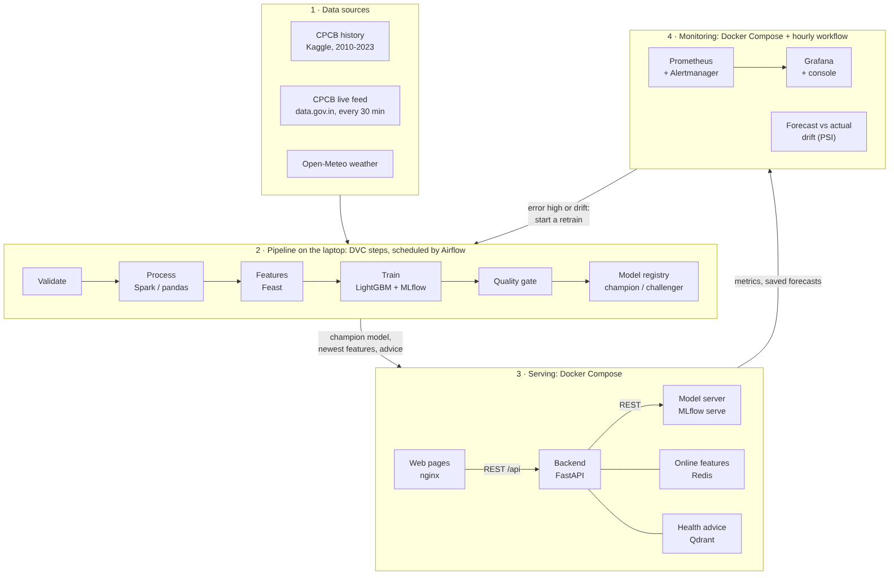

# AirSense — High-Level Design

This document explains **why** AirSense is built the way it is: the main design
choices, the alternatives that were considered, and the reasons for each decision.
**What** the system consists of and how its parts connect is in
[`architecture.md`](architecture.md) (diagram and block descriptions); the endpoint
definitions and input/output formats are in [`lld.md`](lld.md).

Each section starts with a short explanation, followed by a table:
**Choice** (what was built), **Alternatives considered**, **Why**.

## High-level design diagram

1. **Data sources:** the official CPCB measurements (history and live feed) and
   Open-Meteo weather.
2. **Pipeline:** DVC steps on the laptop, scheduled by Airflow, turn the data into
   validated features and a trained model; the quality gate and the registry decide
   which model serves (the *champion*).
3. **Serving:** the web pages talk to the backend only through its REST API; the
   backend reads the newest features (Redis) and the advice texts (Qdrant) and asks
   the model server for the forecast.
4. **Monitoring:** Prometheus, Alertmanager and Grafana watch the service; an hourly
   workflow compares served forecasts with what was measured and checks the inputs
   for drift. A high error or drift starts a retrain: the loop back to step 2.

The detailed component diagram is in [`architecture.md`](architecture.md).

---

## 1. Goal and constraints

**Goal.** For 14 Indian cities, show the current PM2.5 level, forecast the next 24
hours, explain what drives the forecast and tell people what to do about it; and run
all of it as an operated system: data collected and versioned automatically,
models trained, checked and deployed by a pipeline, and the running system watching
its own health and accuracy.

**Constraints that shaped every decision:**

| Constraint | Consequence for the design |
|---|---|
| One laptop: CPU only, 14 GB RAM, about 80 GB disk | Light models, local-mode tools, memory limits on every container, careful disk use |
| No cloud services allowed | Collection, storage, CI, scheduling and monitoring all run on the laptop; backups are on the same disk |
| The live feed has no history | Every hour not collected is lost for good, so collection had to start early and run unattended |

**Success measured by:**

| Measure | Target | How it is checked |
|---|---|---|
| Forecast better than "no change" | on validation: skill ≥ 5 % overall; no hour ahead worse than 1.05 × "no change"; no city below −5 % skill | quality gate, every training run |
| AQI category right | ≥ 70 % of forecasts | quality gate |
| Live forecasts better than "no change" | model error below the "no change" error on served forecasts | hourly forecast-vs-actual check |
| Fresh data | newest measurement at most 4 h old | data validation, LiveDataStale alert |
| Fast answers | 95 % of forecasts within 2 s | Prometheus, SlowForecasts alert |
| Failures noticed | each outage raises an alert within minutes | failure tests ([`test_plan.md`](test_plan.md)) |

**Why this problem.** Air quality offers real live data **and** real ground truth:
new measurements arrive every hour, and the true value of each forecast is known
24 hours later. So production accuracy can
be measured for real, not simulated, and seasons (monsoon, winter smog, Diwali)
cause genuine drift, which gives monitoring and retraining a real job to do. It
also fits a CPU laptop, and the user interface is simple for anyone: pick a city,
see the forecast and the advice.

---

## 2. Framing the problem

Before any modelling, three questions decide what the system forecasts.

| Choice | Alternatives considered | Why |
|---|---|---|
| **Forecast per city**: all reporting stations of a city averaged per hour | One forecast per monitoring station (~150) | People plan by city, not by station. A single station misses about 26 % of hours; a city with several stations reaches 97–100 % coverage. Stations appear and disappear over the years (Delhi: 40 in the history, 57 live), which breaks a station model but not a city series. The historical and live sources name stations differently, while city names match. 14 series are far easier to monitor and display. Cost: variation inside a city is lost |
| **Target: the 24-hour average PM2.5** at each hour | The hourly value | An experiment on the live feed (`notebooks/03_avg_value_experiment.ipynb`) showed that its value is a rolling 24-hour average, not an hourly reading. Using the same quantity for training, live inputs and actuals avoids a built-in mismatch, and CPCB's official AQI for PM2.5 is defined on the 24-hour average. Rebuilding hourly values from consecutive averages would multiply rounding errors by 24 |
| **14 cities** in all regions | All ~100 cities in the data | Chosen in the EDA: at least 97 % hourly coverage since 2020 (Pune kept at 84 % for western coverage), at least 2 live stations, different pollution behaviour per region, no near-duplicates of a larger city (e.g. Noida next to Delhi). Adding cities is a settings change in `params.yaml`; nothing in the code, model or dashboards grows per city |
| **24 hours ahead**, one value per hour | Only the value in 24 h; several days | A curve shows when it gets worse or better during the day, which is what people plan around; beyond a day the weather forecast and the persistence of pollution both weaken |

---

## 3. Data

| Choice | Alternatives considered | Why |
|---|---|---|
| **CPCB measurements throughout**: history from the Kaggle CPCB dataset (2010–2023), live inputs and actuals from the CPCB real-time feed on data.gov.in | Open-Meteo PM2.5 everywhere; CPCB history with Open-Meteo PM2.5 live | Training, serving and evaluation see the same kind of numbers (station measurements). Open-Meteo PM2.5 is a model estimate on a ~45 km grid, not a measurement; mixing the two sources would make the monitoring report "drift" that is really two sources disagreeing |
| **Kaggle 2010–2023** dataset (453 stations), downloaded with the Kaggle API | The popular 2015–2020 dataset; a manual browser download | More recent, more stations and cities. A scripted download is repeatable and documents exactly where the data came from |
| **Open-Meteo weather** for both training (archive) and serving (forecast) | Station weather from the Kaggle files; no weather | The live feed has no weather, so Open-Meteo is needed at serving anyway; using the same provider in training keeps the feature definitions identical. Station weather is patchy and measured elsewhere than serving's. Without weather, longer horizons are weaker and there is no weather drift to watch |
| **Accept archive-vs-forecast weather skew** and measure it | Train on past forecasts; add noise to the archive | In training the model sees the weather that happened; at serving, the weather forecast. Past forecasts are not available for 2018–2023, and a noise level would be a guess. The skew is documented and the observed weather of the saved forecasts is used in drift checks |
| **Accept the 2023–2026 gap** (history ends March 2023, live starts October 2026) and treat it as drift | Fill it from the CPCB portal by hand; OpenAQ | A genuine drift-and-retrain story instead of a simulated one; serving is not blocked because recent inputs come from live data. Manual portal downloads (captchas, ~150 stations) cannot be automated |
| **UTC everywhere** in storage; Indian time only for calendar features and display | Local time in files | Mixing time zones silently shifts lag features by 5.5 hours. Calendar effects follow local life, so hour, weekday and the Diwali flag are computed in IST |
| **Raw data never edited**; all cleaning writes new files | Clean in place | A cleaning bug can always be fixed and re-run from the untouched original |
| **Collector every 30 minutes** (minutes 5 and 35) with retries and a clear exit code | Once an hour | CPCB publishes late and unevenly; a second run catches late stations. Repeated readings are removed in processing. Exit codes let the scheduler tell success, failure and "the source was empty" apart |

---

## 4. Data engineering

| Choice | Alternatives considered | Why |
|---|---|---|
| **PySpark in local mode** for the 14-year history (6.7 M station-hours) | A Spark cluster on the same laptop; pandas | The data fits one machine. A cluster on the same laptop adds no cores or memory but costs 2–3 GB of RAM that the rest of the stack needs. The code is the same for a cluster; only the master address changes |
| **pandas for the live batches** (~500 rows per snapshot), with **exactly the same output columns** as the history | Spark for live data too | Spark needs ~10 s just to start for under a second of work. The tool is chosen by data volume; the identical output schema keeps everything after it shared |
| **Validation with critical and warning checks** (Great Expectations), on raw data, processed data and weather | Every check stops the run; every check only warns | Real data always has small problems. One broken station file must not stop 13 healthy cities (it is quarantined), but losing a whole city stops the run. Warnings (coverage, stale or thin live data) become monitored signals instead of failures, which avoids alert fatigue |
| **Freshness limit 4 hours** for live data | 3 hours | The normal age is about 2.5 h (CPCB's hour label, about 1 h publication lag, up to 30 min until collection). A 3 h limit fired during normal operation |
| **No imputation**: hours without a target are dropped; missing inputs left empty for the model | Interpolation | Filling targets invents labels and inflates test scores; most gaps are station outages of weeks. Interpolating inputs looks at the value after the gap (leakage) and cannot be done at serving time (skew). LightGBM handles missing inputs natively |
| **Deterministic outputs**: sorted rows, fixed file names | Library defaults | With random row order or file names, identical data had different bytes, DVC stored a new 1.2 GB copy and re-ran every later step. Now the same inputs give byte-identical files, which can be shown, not just claimed |

---

## 5. Features and the feature store

| Choice | Alternatives considered | Why |
|---|---|---|
| **One model with the hours ahead (1–24) as an input** | 24 separate models; recursive forecasting; only the value in 24 h | One model to track, register, serve, monitor and roll back, and one explainer. Recursive forecasting compounds errors and needs hourly values the feed does not provide. Cost: the training table is 24 times larger (14.3 M rows), handled with compact data types |
| **About 40 inputs**: current level, lags up to 72 h, recent changes, 72 h rolling mean and max, calendar of the target hour, weather now and at the target hour, city and region | A 24 h or 7-day look-back; other pollutants | Every input must be computable at serving time from live data. 72 h captures multi-day build-ups and is complete after 3 days of collection; 7 days would need a week of unbroken data. Lags and windows are settings in `params.yaml` |
| **Weather at the middle of the PM2.5 hour** | Weather at the start of the hour; an average of two hours | PM2.5 rows are labelled at :30 UTC (India is UTC+5:30), weather at whole hours; the middle is the best single representative and a simple, tested rule |
| **Feast** with **DuckDB** as offline store and **Redis** as online store | No feature store; Feast's default file store; SQLite online | Feast's point-in-time join builds the training table so that no row can see data from its future. The default offline store ran out of memory on 2,000 rows; DuckDB joined the full training size (about 644 k rows) with about 1 GB. Redis can be written by the pipeline and read by the backend container at the same time, which a shared SQLite file cannot do safely. The switch from SQLite (development) to Redis was a configuration change only |
| **One feature function** used by training and serving | Separate code for each | The same `weather_features()`, `calendar_features()` and category codes run in both, and a unit test requires the serving rows to equal the training rows for the same moment. This removes the most common cause of training/serving skew |

---

## 6. Model

| Choice | Alternatives considered | Why |
|---|---|---|
| **LightGBM** (gradient-boosted trees) | Deep learning (LSTM, Transformer); linear models | Tabular inputs, CPU only: trees train in about a minute on 14 M rows, handle missing values and categorical cities natively, and give exact explanations (TreeSHAP) in milliseconds. Deep sequence models need far more compute for little expected gain on 40 tabular inputs |
| **Predict the change** from the current value, with an **L1 (absolute error) objective** | Predict the level with squared error | The first model was worse than "no change" for the next 1–3 hours: the next 24-hour average shares 23 of its 24 hours with the current one, and rebuilding the whole level loses that. Predicting the change fixed it; L1 optimises the main metric (MAE) directly. Validation MAE 4.94 → 4.48 |
| **"No change" (persistence) as the baseline to beat**, plus "same hour yesterday" | Only absolute error | For a 24-hour average, persistence is strong; skill over it shows what the model adds. MAE is easy to explain; AQI-category accuracy is what the advice depends on |
| **Time-based split with one-day gaps**: train 2018–2021, validation Jan–Sep 2022, test Oct 2022 – Mar 2023 | Random split; rolling cross-validation | Never evaluate on the past; the gap stops overlapping 24-hour windows from leaking across a boundary. Models are chosen on validation; test (the hardest months: winter and Diwali) is only looked at to confirm. Rolling cross-validation would cost about 5 times the training time |
| **Training years 2018–2023**, COVID lockdown kept | All years from 2010; only 2020–2023 | Five winters and Diwali seasons, while avoiding years when many cities rest on one or two patchy stations; the lockdown is about 4 % of rows and slightly widens the drift reference |
| **Memory-saving training**: one float32 array built column by column, splits as masks | Library defaults | The first version needed over 12 GB and was killed by the operating system; now the peak is about 6 GB |
| **Live data added to training** as a separate table that joins only the training split, with a share of the weight (target 10 %, at most 20 copies per row) | Train on live data only; keep the history only | Without live rows a retrain only re-reads 2018–2023 and cannot adapt. A few weeks of 2026 cannot replace five years of seasons, so live rows get at most a 10 % share; while there are few live rows the 20-copy cap keeps it lower (4.6 % in the latest retrain), so a few days are never memorised. Keeping them out of validation and test means old and new models are compared on the same data. The newest 2 days are held back to report the error on recent live data |
| **Live rows repeated** (up to 20 times) instead of row weights | LightGBM row weights | With the L1 objective, unequal weights make LightGBM use a weighted median that is much slower: training went from about 80 s to 19 min. For whole numbers, k copies move a median exactly like weight k |

**Result:** test MAE 6.80 µg/m³ against 8.59 for "no change" (21 % better), better at
every horizon, AQI category right about 83 % of the time.

---

## 7. Versioning, tracking and the quality gate

| Choice | Alternatives considered | Why |
|---|---|---|
| **Git for code, DVC for data and models**, with a link-based cache | Data in Git; no data versioning | A commit then pins code, data and settings together; `git checkout` + `dvc checkout` restores any version. Links avoid copying 1.6 GB into the cache on a filesystem without reflinks |
| **The whole pipeline as DVC stages** (15, `dvc.yaml`), settings in `params.yaml` | Scripts run by hand; a Makefile | `dvc repro` runs everything in order and re-runs only what changed in code, data or settings; `dvc.lock` records exactly what produced each output. One settings file avoids configuration scattered through the code |
| **DVC remote in a folder outside the project** | No remote; Google Drive; an external disk | Gives the push/pull workflow and a second copy that survives deleting the project. Cloud remotes are not allowed and no external disk was available. Limitation: it is on the same disk |
| **MLflow** tracking (SQLite backend) with the **Model Registry** | Logging to files; Weights & Biases | Every run records its settings, metrics per horizon and city, plots, the model with its input signature, the Git commit and the DVC fingerprint of its training data, so each model can be traced to its code and data. The registry needs a database backend; SQLite is enough for one machine |
| **Quality gate** before registration: five checks on validation (overall skill, every horizon, every city, AQI accuracy, sane predictions) | Register every model | These are the failure modes actually seen: the first model would have been stopped by the per-horizon check. Small tolerances avoid failing on noise. A failed gate stops the pipeline; the current model keeps serving |
| **Champion / challenger**: a new model replaces the champion only if it is at least 1 % better, with both scored on the **same** validation rows | Always serve the newest model | Comparing stored numbers is unfair when the data has changed; re-scoring both is not. The 1 % margin avoids swapping models over noise. `registry.json` in Git records which version was champion at each commit (rollback) |
| **MLflow Project** (`MLproject`, `python_env.yaml`): the environment (Python 3.12, the pinned packages) and entry points for the tests and the pipeline | Conda environment file; instructions only | `mlflow run . -e tests` runs the tests in the project's environment, or with `--env-manager virtualenv` in a fresh one built from the same pins: development and test environments are identical; the serving image uses the same pins as constraints |
| **Local CI**: a Git pre-commit hook runs lint, a format check and the 154 quick tests | GitHub Actions | Cloud CI is not available; the hook gives the same guarantee locally: no commit with lint errors or failing tests. With the DVC stages (validation, gate, registry) it is the project's CI |
| **Reproducibility checked with a fresh clone** | Assume it | Retraining in a fresh clone gave a byte-identical model (same md5), because both the data and the training are deterministic |

---

## 8. Serving

| Choice | Alternatives considered | Why |
|---|---|---|
| **Two services**: an MLflow model server (the champion over REST) and a FastAPI backend (everything else) | The backend loads the model itself; BentoML or Seldon | The standard, registry-driven way to deploy a model; a new model needs no backend change, and each part can be restarted on its own. BentoML/Seldon add more services to run for no gain on a single machine. Cost: one extra HTTP call (10–75 ms). The backend loads the same model version only to compute explanations, never forecasts |
| **Online REST serving**, a forecast computed per request (about 70 ms) | Pre-computed batch forecasts | Always uses the newest data and weather; cheap enough at this scale |
| **"No forecast" is a normal answer** (HTTP 200 with a reason); 503 only when a dependency is down | An error for stale data | Old or missing data is a true statement about the world, not a server failure; clients can tell "retry later" (503) from "no data" |
| **No forecast without fresh data** (the current value at most 4 h old) | Forecast from old values | A forecast from stale data looks trustworthy but is not; the page says why and shows the last known reading and nearby cities instead |
| **Weather:** one request for all cities, cached 30 min, a 10 s limit, then the newest saved forecast | Retry until it works; send empty weather | A failed weather call once blocked requests for minutes, and empty weather made the model server reject every forecast. A recent real forecast is closer to what the model was trained on |
| **Explanations with TreeSHAP**, averaged over the 24 hours, the 6 largest factors in plain words plus "all other factors combined" | The `shap` library; no explanation | LightGBM's built-in TreeSHAP is exact and takes milliseconds. Inputs that are missing are not listed (their effect goes into "all others"), so the page never says that a reading which does not exist raised the forecast |
| **Health advice from our own texts** (6 AQI categories × 3 groups, based on CPCB and WHO), searched with sentence embeddings in **Qdrant** | A hard-coded table; an LLM writing advice | Category and user group are exact filters, so the advice always matches both (matching the group by meaning alone once gave the general public the outdoor workers' text). Sources are returned with each text. A vector store lets texts be added without code changes and is the base for a future question-answering extension; an LLM could produce unverified medical advice and needs a GPU |
| **Plain HTML, CSS and JavaScript** with Chart.js, served by nginx | React; Streamlit; pages served by FastAPI | Two pages need no framework or build step; full control over layout and accessibility; a clean split from the API. Streamlit limits layout and blurs the split |
| **Two pages**: Forecast for the public, Pipeline console for operators | One page | Different readers with different questions; the public never sees pipeline details |
| **The console reads the pipeline's own records** (`dvc.yaml`, `dvc status`, step reports, registry record, collector logs, Airflow run log) and is read-only | A separate status database; a console that starts runs | Always current with no extra bookkeeping, and a new pipeline step appears automatically. Starting runs is Airflow's job |
| **Accessibility**: official CPCB colours always with the category written next to them, keyboard use, light and dark theme, phone layout | Colour only | Colour-blind users read the text; the colours are the ones people know from news and government apps |

---

## 9. Deployment

| Choice | Alternatives considered | Why |
|---|---|---|
| **Only serving and monitoring run in containers** (8, Docker Compose); the pipeline runs on the laptop | Everything in containers | Serving is what users reach and must start the same way everywhere. The pipeline needs Spark, Java, the full data and long runs, which would make a very large image for no gain. The two halves meet only through files and stores |
| **One application image** for backend and model server, multi-stage, CPU-only PyTorch, non-root user, tagged with the Git commit | Two images; the full GPU PyTorch | Both need the same packages and code: one build, about 3.3 GB instead of two. The tested environment's versions are used as constraints, so the container has the same packages as the tests. The commit tag shows exactly which code is running |
| **Project folder mounted read-only at the same path** | Copy the model into the image; an MLflow server with an artifact store | The MLflow database and the Feast registry store absolute paths; the same path makes them valid in the container. A new champion needs a restart, not a rebuild, and a container cannot change code, models or the pipeline's data (the backend writes only two folders: saved weather forecasts and received alerts) |
| **Only nginx is public** (port 8080); it forwards `/api` to the backend and fails fast | Publish every service | One address for the browser, the smallest attack surface. The backend, Redis, Qdrant, Prometheus, Alertmanager and Grafana listen on 127.0.0.1 only; the model server has no published port |
| **Health checks, start order, restart policy and memory limits** for every container | Defaults | No service starts before what it needs is healthy; a crash is repaired without a person; limits keep one service from starving the 14 GB laptop |
| **One settings module**; environment variables override `params.yaml` | A second settings file for Docker | The same code runs on the laptop and in containers; only addresses change |

---

## 10. Orchestration

| Choice | Alternatives considered | Why |
|---|---|---|
| **Apache Airflow** in its own Python environment on the laptop | Cron; Airflow in the project's environment; the official Airflow Docker stack | Cron has no retries, run history or UI. Installing Airflow into the project's environment would have replaced 16 packages the pipeline depends on. The official Docker stack needs 5–6 containers (about 4 GB RAM) and a custom image with the whole pipeline |
| **Four workflows by rhythm**: live (every 30 min), monitor (hourly), retrain (weekly and on demand), housekeeping (daily) | One workflow for everything; one per DVC step | Different jobs need different rhythms; one workflow per rhythm keeps each graph readable |
| **Each task runs one DVC stage**, all DVC tasks in a one-slot pool | Calling the Python scripts directly | DVC keeps deciding what changed and keeps `dvc.lock` correct; Airflow adds the schedule, order, retries, logs and graph. DVC locks the repository, so the pool makes sure two DVC commands never run at once |
| **A new model is served only when the champion changed**: restart of model server and backend, then wait until the health check confirms the new version | Restart after every retrain; a canary rollout | A needless restart is downtime for nothing. A canary needs two model servers, traffic routing and about a day of actuals to judge; the champion rule already compares the two models on the same data |
| **Missed runs are not replayed** | Catch up after the laptop wakes | The live feed only has the current hour, so a replay would collect "now" several times |
| **Data versioned daily**: `dvc add` + `dvc push` of the live snapshots and saved forecasts, one checkpoint commit per day | A commit every 30 minutes | Live snapshots cannot be downloaded again, so they must be backed up; 48 commits a day would bury the real history |
| **Run results written to a file** read by the console | Airflow's REST API | The API needs a login token, so the backend container would need the admin password and a route to the laptop |

---

## 11. Monitoring and automatic retraining

| Choice | Alternatives considered | Why |
|---|---|---|
| **Prometheus, Alertmanager and Grafana** in the same Compose project, local only | A hosted service; logs only | The standard open-source stack; one command starts serving and monitoring together. Dashboards and alert rules are files in Git |
| **13 alert rules**, each with a waiting time; the cause suppresses its symptoms | Alert on every blip | A short glitch does not page anyone; when the model server or Redis is down, the error-rate and slow-forecast alerts are held back so the cause is shown, not ten symptoms. Rules are tested with `promtool` |
| **Alerts delivered to the console** (Alertmanager → backend → console) | E-mail, chat | Needs no extra account or secret; e-mail is one more receiver in the configuration |
| **An empty source is not a failure**: the collector reports "source empty" and the run is skipped (amber), not failed (red) | Treat it as a failure | When CPCB's feed was empty for 40 minutes, a red run blamed our pipeline for a gap at the source |
| **Forecast vs actual**: every served forecast saved and compared 24 hours later with the measurement and with "no change" | Accuracy from the test set only | The real error on current data, per city and hours ahead. "High" means above 1.5 × the champion's test error **and** worse than "no change", with at least 100 pairs, so a hard season alone does not raise it |
| **Drift with PSI**, own code, daily, compared with training rows of the **same months** | Comparing with the whole year; a drift library | Every season differs from the yearly average, so a whole-year reference would always report drift. PSI is simple, explainable and needs no extra dependency. 0.2–0.3 moderate, above 0.3 drift |
| **Automatic retrain** on drift or high error, at most every 3 days; the gate and the champion rule still decide | Retrain on a timer only; retrain every 30 minutes | Retraining when monitoring finds a problem closes the loop without a person; the cooldown stops a persistent problem from retraining again and again. A retrain costs a few minutes of CPU and memory, and 30 minutes adds only about 14 city-hours, so constant retraining would waste resources |
| **Disk space watched** (alert below 5 GB) | Not monitored | A rebuild needs a new 3.3 GB image; one outage happened at about 2 GB free |

---

## 12. Code structure and programming style

The code is **mostly functional**: the data steps, features, metrics, drift and
monitoring checks are plain functions that take data and return data (for example
`weather_features()`, `expand_horizon()`, `psi()`), each step with a small `main()`
that reads its inputs and writes its outputs. That keeps them easy to test with tiny
inputs and lets training and serving share the very same functions. **Classes** are
used only where something keeps state while the service runs: `ForecastService`
(loaded model, caches, connections), `ModelServerClient`, `PipelineStatus` (cached
console data), `Metrics` (Prometheus registry) and `AlertStore`; the API's request and
response formats are pydantic classes (`backend/main.py`). The frontend and the
backend are separate programs that meet only through the REST API, whose address is
a setting (`frontend/assets/config.js`; `/api` through nginx in the containers).

| Choice | Alternatives considered | Why |
|---|---|---|
| Functions for data and model steps, classes for stateful services | Everything in classes | Functions without hidden state are the simplest to test and to reuse between training and serving |
| One step = one script with `main()`, run by DVC | One large application | Each step can run, fail and be retried on its own; DVC tracks its inputs and outputs |
| Style: ruff (lint and format, PEP 8), docstrings and comments on every module | — | Checked on every commit by the pre-commit hook |

---

## 13. Security

| Choice | Why |
|---|---|
| API keys and the Grafana password only in `.env` (not in Git, not in images); `.env.example` with empty values | Secrets never reach the repository or a container image |
| The API key is removed from every log message | Library error messages can contain the full request address, including the key |
| Containers run as a non-root user; the project folder is read-only inside them | A compromised container cannot change code, models or the pipeline's data; the backend can write only to its two own folders (saved weather forecasts, received alerts) |
| Only the web page is reachable from the network; all other services listen on the laptop only; `/metrics` and `/alerts` are not forwarded by nginx | The smallest attack surface; visitors cannot read internal metrics or post alerts |
| No personal data is collected or stored (only public measurements and weather) | Nothing about visitors needs protecting; the page keeps only the theme choice in the browser |
| Not encrypted: traffic is plain HTTP inside the laptop and the local network | Acceptable for one machine; for a public deployment, HTTPS would be added at nginx (one certificate, no change to the services) |

---

## 14. Trade-offs accepted

| Trade-off | Reason it was accepted | Where it is described |
|---|---|---|
| Collection only while the laptop runs | No cloud allowed; hours when it is off are lost for good | `architecture.md` §9 |
| A single machine; the DVC backup on the same disk | No cloud, no second disk; containers make a move to a server a configuration change | `architecture.md` §9 |
| Archive weather in training, forecast weather in serving | No historical forecasts for 2018–2023 | §3 above |
| Little live data in training so far | A few weeks of collection; retrained models have not yet beaten the champion by 1 % | `architecture.md` §9 |
| Live feed values are AQI sub-indices, history is µg/m³ (found after release, not yet converted) | The window was verified (24 h) but not the scale; the conversion with the CPCB breakpoints is planned | `data_sources.md` §3 |
| Forecasts per city, not per station | Simpler, more complete series; variation inside a city is lost | §2 above |
| Built for one machine; scaling is prepared, not done | More cities are a settings change; Spark switches to a cluster by its master address; the containers can move to Docker Swarm or Kubernetes unchanged | `architecture.md` §9 |

**Possible extensions:** e-mail alerts, starting Airflow with the laptop, a map view,
station-level forecasts, more cities, a second backup disk, a question-answering
assistant on top of the advice texts.
