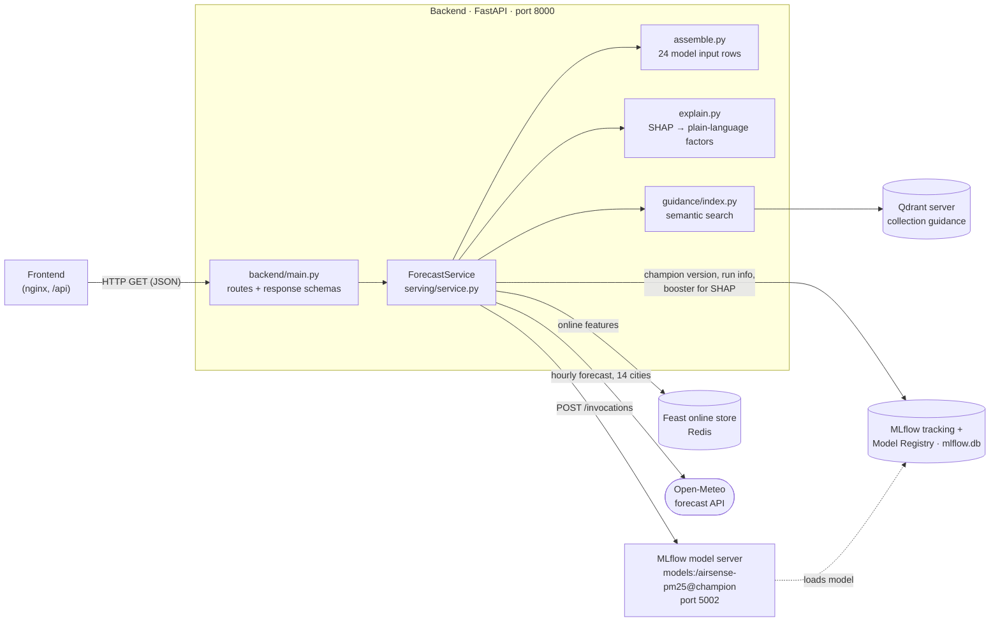
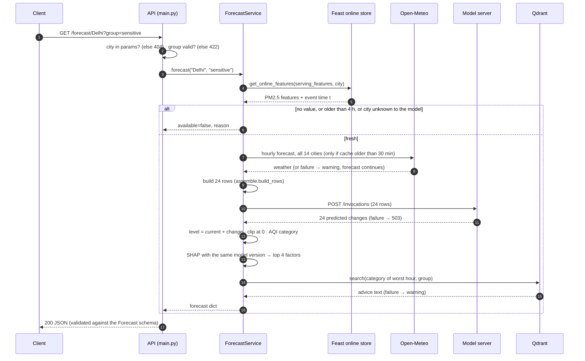

# AirSense — Low-Level Design (serving)

This document describes how the AirSense serving system is built: its components,
the API contract, the request flow, the model input contract, error handling,
configuration and tests. It covers the code in `model_server/`, `backend/`,
`src/airsense/serving/`, `src/airsense/guidance/` and the web pages in `frontend/`
(Forecast page and Pipeline console; their use is described in `docs/user_manual.md`).
How these parts are deployed as containers, and how to run them, is in
`docs/architecture.md`.

The data pipeline that produces the model and the features (ingestion, Spark
processing, Feast, training, gate, registry) is described in
`docs/data_sources.md` and `docs/features.md`; it appears here only where serving
reads its outputs.

---

## 1. Components



| Component | Code | Responsibility | Reads | Writes |
|---|---|---|---|---|
| Model server | `model_server/serve.sh` (`mlflow models serve`) | Serves the **champion** model over REST; nothing else | MLflow Registry (`mlflow.db`, `mlruns/`) | — |
| Backend API | `backend/main.py` | HTTP routes, request validation, response schemas, error → status code mapping, CORS | — | — |
| ForecastService | `src/airsense/serving/service.py` | One forecast end to end: freshness check, weather, input rows, model call, AQI, explanation, guidance | Feast online store, Open-Meteo, MLflow, Qdrant | weather snapshots `data/raw/live/openmeteo/` |
| Row builder | `src/airsense/serving/assemble.py` | Builds the 24 input rows exactly as training did | — | — |
| Explanations | `src/airsense/serving/explain.py` | Turns SHAP values into the top factors in plain words | — | — |
| Guidance index | `src/airsense/guidance/index.py`, `guidance_docs/` | Builds (DVC stage `guidance_index`) and searches the health-advice collection | `guidance_docs/*.md` | Qdrant collection `guidance`, `data/interim/guidance_index.json` |
| Pipeline status | `src/airsense/serving/pipeline.py` | Read-only summary for the operators' console: steps and graph, `dvc status`, step reports, throughput, gate, registry, collection health, recent log problems; cached 60 s | `dvc.yaml`, `data/interim/*.json`, snapshot folder, `logs/*.log` | — |
| Settings | `src/airsense/common/settings.py` | One place for the project folder, `params.yaml` with environment overrides, and the Feast store with the Redis address; the same code runs on the laptop and in the containers | `params.yaml`, `feature_repo/feature_store.yaml`, environment | — |
| Web pages | `frontend/` (HTML, CSS, JavaScript, Chart.js included) | Forecast page for users, Pipeline console (four tabs) for operators; light and dark theme; one time format ("Mon 2 Nov, 11:00 IST"); call the API over HTTP only | the API | browser storage: the theme choice only |

**Why two serving processes.** The model server is MLflow's standard way to serve a
registered model; it knows nothing about cities, weather or users. The backend owns
all application logic. A new model version therefore needs no backend code change,
and the model server can be restarted or replaced on its own (it runs in its own
container).

**Why the backend also loads the model.** SHAP explanations need the LightGBM
booster itself (`pred_contrib=True`), which the REST interface does not expose. The
backend loads the **same registry version** the model server serves (resolved through
the `champion` alias at startup) and uses it only for explanations; forecasts always
come from the model server. `/health` reports if the two could differ (§6). Both load
the model from a temporary copy, because MLflow writes a small file
(`registered_model_meta`) into the folder it loads from, and in the containers the
model store is mounted read-only.

---

## 2. API contract

Base URL: `http://127.0.0.1:8000` (in the containers the web pages reach it as `/api`
through nginx). All endpoints are `GET`, return JSON, and are
documented interactively at `/docs` (OpenAPI, generated from the schemas in
`backend/main.py`).

### 2.1 Endpoints

| Endpoint | Parameters | Success | Errors |
|---|---|---|---|
| `GET /health` | — | 200: status of model server, feature store, champion version | — (problems are reported in the body, never as an error) |
| `GET /cities` | — | 200: latest PM2.5 for all 14 cities | 503 live data store unavailable or being refreshed |
| `GET /forecast/{city}` | `city` (path, exact name, e.g. `Delhi`); `group` (query: `general` · `sensitive` · `outdoor_workers`, default `general`) | 200: forecast, or `available: false` with a reason | 404 unknown city · 422 invalid `group` · 503 model server or live data store unavailable |
| `GET /model` | — | 200: champion model and its metrics | — |
| `GET /guidance` | `category` (query, required: `Good` · `Satisfactory` · `Moderate` · `Poor` · `Very Poor` · `Severe`); `group` (as above) | 200: best-matching advice | 422 invalid value · 503 guidance index unavailable |
| `GET /pipeline` | — | 200: pipeline status for the operators' console | — (a failed `dvc status` is reported in the body) |

### 2.2 Status codes

| Code | Meaning | Example |
|---|---|---|
| 200 | Request handled. For `/forecast` this includes "no forecast possible" (`available: false`), because that is a valid answer about the data, not a failure of the service | data older than 4 h |
| 404 | The city is not one of the 14 configured cities | `/forecast/Atlantis` |
| 422 | A parameter has a value outside its allowed set (checked by FastAPI from the schema) | `group=everyone` |
| 503 | A dependency is down; the client may retry later. The cause is logged, not sent | model server stopped |
| 500 | Not expected; any unhandled error. Covered by tests for every known failure (§8) | — |

### 2.3 `GET /forecast/{city}` response

| Field | Type | Unit / values | Meaning |
|---|---|---|---|
| `city`, `region` | string | — | as in `params.yaml → data.cities` |
| `generated_at_utc` | string (ISO 8601) | UTC | when the answer was computed |
| `available` | bool | — | `false` → no forecast; see `reason` |
| `reason` | string or null | — | why no forecast (only when `available` is false) |
| `model` | object | `name`, `version`, `target_mode` | the champion that produced the forecast |
| `current.pm25_24h` | float | µg/m³ | latest 24-hour average PM2.5 (city mean of stations) |
| `current.aqi_category` | string | CPCB category | of the current value |
| `current.time_utc`, `current.time_ist` | string | UTC ISO / `"Fri 23 Oct 16:00"` IST | the hour the current value describes |
| `current.age_hours` | float | hours | `generated_at` − that hour |
| `current.stations` | int | — | stations behind the city value |
| `forecast[]` | list of 24 | — | one entry per horizon |
| `forecast[].horizon` | int | 1 … 24 | hours ahead of `current.time_utc` |
| `forecast[].time_utc`, `.time_ist` | string | — | the hour forecast |
| `forecast[].pm25` | float | µg/m³, ≥ 0 | forecast 24-hour average PM2.5 |
| `forecast[].aqi_category` | string | CPCB category | of the forecast value |
| `worst_next_24h` | object | `time_ist`, `pm25`, `aqi_category` | the highest forecast hour |
| `explanation[]` | list (≤ 6) | `factor`, `effect_ug_m3`, `direction` (`raises` · `lowers`) | inputs that moved this forecast most (§3.6) |
| `explanation_other_ug_m3` | float or null | µg/m³ | all other inputs combined, so the listed factors plus this add up (§3.6) |
| `guidance` | object or null | `category`, `pm25_range`, `group`, `text`, `sources[]`, `score` | advice for the worst category and the chosen group |
| `warnings[]` | list of strings | — | anything degraded (§6) |
| `model_latency_ms` | float | ms | time of the model-server call |

CPCB AQI categories for 24-hour PM2.5 (µg/m³): Good 0–30, Satisfactory 31–60,
Moderate 61–90, Poor 91–120, Very Poor 121–250, Severe > 250.

Example (shortened; real response, 23 Oct 2026):

```json
{
  "city": "Delhi", "region": "North", "available": true,
  "model": {"name": "airsense-pm25", "version": 1, "target_mode": "change"},
  "current": {"pm25_24h": 221.8, "aqi_category": "Very Poor",
              "time_utc": "2026-10-23T10:30:00+00:00", "time_ist": "Fri 23 Oct 16:00",
              "age_hours": 2.7, "stations": 56},
  "forecast": [
    {"horizon": 1, "time_utc": "2026-10-23T11:30:00+00:00", "time_ist": "Fri 23 Oct 17:00",
     "pm25": 223.4, "aqi_category": "Very Poor"},
    "... 23 more ..."
  ],
  "worst_next_24h": {"time_ist": "Sat 24 Oct 05:00", "pm25": 231.2, "aqi_category": "Very Poor"},
  "explanation": [
    {"factor": "change over the last 1 hour", "effect_ug_m3": 8.5, "direction": "raises"},
    {"factor": "this city's usual level", "effect_ug_m3": 3.3, "direction": "raises"},
    {"factor": "PM2.5 12 hours ago", "effect_ug_m3": -2.7, "direction": "lowers"},
    {"factor": "PM2.5 6 hours ago", "effect_ug_m3": -2.3, "direction": "lowers"},
    "... 2 more ..."
  ],
  "explanation_other_ug_m3": -0.9,
  "guidance": {"category": "Very Poor", "group": "sensitive", "pm25_range": "121-250 µg/m³ (24-hour average)",
               "text": "Children, older adults and people with asthma, heart or lung disease should stay indoors ...",
               "sources": ["CPCB, National Air Quality Index (2014) ...", "WHO, Global Air Quality Guidelines (2021) ..."],
               "score": 0.724},
  "warnings": ["Some past readings are missing (PM2.5 48 hours ago), so this forecast may be less accurate."],
  "model_latency_ms": 11.3
}
```

When no forecast is possible:

```json
{"city": "Delhi", "region": "North", "available": false,
 "reason": "latest PM2.5 value is 6.8 h old (limit 4 h)",
 "model": {"name": "airsense-pm25", "version": 1, "target_mode": "change"},
 "current": null, "forecast": [], "explanation": [], "guidance": null, "warnings": []}
```

### 2.4 Other responses

- **`/health`** — `{"status": "ok" | "degraded", "checks": {"model_server": bool, "feature_store": bool, "champion_up_to_date": bool}, "model_version": …, "registry_champion": …}`; `degraded` if any check is false.
- **`/cities`** — list of `{city, region, pm25_24h, aqi_category, age_hours}`; values are `null` for a city without data.
- **`/model`** — `{name, version, run_id, target_mode, val_mae, test_mae, test_skill, trained_at, training_data_md5}` from the MLflow run of the champion.
- **`/guidance`** — list (one item) of the guidance object described above.
- **`/pipeline`** — `{generated_at_utc, dvc_status_error, stages[], edges[], throughput[], gate, registry, champion, collection, recent_problems[]}`:
  - `stages[]`: `{name, cmd, status, reasons[], last_run_utc, report_file, report}`, where `status` is `up to date`, `changed` (with the changed inputs as reasons), `runs every time` or `unknown` (if `dvc status` failed, e.g. while a pipeline run holds DVC's lock);
  - `edges[]`: `[from, to]` pairs, derived from `dvc.yaml` (an output of one step is an input of the other);
  - `throughput[]`: `{stage, rows, seconds, rows_per_second}` from each step's report;
  - `collection`: last snapshot time and age, snapshots in the last 24 h (48 expected), gaps longer than 45 min (`{from_utc, to_utc, minutes, ongoing}`; the start of the 24-hour window and "now" count as edges, so a stopped collector shows as an ongoing gap), snapshot times;
  - `recent_problems[]`: the newest WARNING/ERROR lines of `logs/*.log`;
  - `workflows[]`: `{dag_id, state, run_type, start_utc, end_utc, minutes_ago, duration_min, url}`, the latest run of each Airflow workflow, read from `logs/airflow_runs.json` (written by the DAGs when a run ends; Stage 9), and `airflow_url` for the links.
  The result is cached for `serving.pipeline_cache_seconds` (60), so console refreshes do not run `dvc status` each time.

---

## 3. Forecast request flow



### 3.1 Live PM2.5 features

`FeatureStore.get_online_features(features=serving_features, entity_rows=[{"city": …}])`
returns the newest row of the `pm_live` feature view for the city, with its event
time (`include_event_timestamps=True`). The online store is filled by the DVC stage
`feast_online` (materialization of the last 7 days of live features; newest row per
city wins).

**Freshness rule.** `age = now − t`. A forecast is made only if a current value
exists and `age ≤ validation.processed.max_live_age_hours` (4 h). The normal age is
about 2–3 h: the hour label is the start of the hour, CPCB publishes about an hour
later, and collection runs every 30 minutes. Feast's own TTL is not used for this:
the online store does not apply it on reads, and an explicit rule in the service is
visible in the answer ("latest PM2.5 value is X h old") and covered by tests.

**Online store.** Redis (a container since Stage 8); writes by `feast_online` replace
a city's row atomically. The connection string in `feature_store.yaml` carries
`retry=null,socket_connect_timeout=2,socket_timeout=2`: without `retry=null` the Redis
client retries a failed connection three times with growing waits (about 7 s per
read), so a stopped Redis kept a page waiting for a minute. The containers replace
only the address (`REDIS_CONNECTION=redis:6379`); the options are kept.
`skip_dedup: true` (Stage 9): Feast's Redis writer otherwise skips a row whose time
equals the stored one, so a late station that revised the newest hour never reached
Redis and the online/offline check in `feast_online` failed. Safe here: materialization
writes only the newest row per city, and one writer runs at a time (Airflow's `dvc`
pool). `feast_online` runs every 30 minutes (Airflow `airsense_live`).

### 3.2 Weather

- One Open-Meteo **forecast** request covers all 14 cities (`past_days: 2`,
  `forecast_days: 3`): the past hours give the weather "now" and the 24-hour rain sum,
  the future hours cover every target hour up to *t* + 24.
- The response goes through the **same `weather_features()`** as training (wind
  direction as sin/cos, 24-hour rain sum, relabelling by −30 min so that weather at
  11:00 UTC describes the PM2.5 hour labelled 10:30).
- The table is cached for `serving.weather_cache_minutes` (30). A request makes **one
  attempt with a 10 s timeout** (`serving.weather_timeout_seconds`); the patient
  settings of the training download (60 s, 3 attempts) would keep a user waiting
  for minutes.
- If the call fails, the service uses the **newest saved forecast snapshot** (below)
  and adds the note "The live weather forecast is unavailable, so this forecast uses
  the weather forecast fetched …". One fetch covers three days, so a snapshot from earlier the same day still
  covers the next 24 hours. The live call is retried after
  `serving.weather_retry_minutes` (5).
- Every successful fetch is saved to `data/raw/live/openmeteo/<date>/<HHMM>.csv`.
  These snapshots are the input for the forecast-versus-archive weather comparison
  in Stage 10 (training used archive weather, serving uses forecasts).

### 3.3 Model input rows

`assemble.build_rows()` creates one row per horizon *h* = 1 … 24 with the model's
columns in the model's order (§4).

### 3.4 Prediction

The rows are sent as pandas "split" JSON to `POST /invocations` (missing values as
`null`). The champion was trained in **change** mode: it predicts
`pm25_24h(t + h) − pm25_24h(t)`, so the service adds the current value back
(`to_level`, the same function training used for evaluation). Forecasts below 0 are
set to 0 with a warning; a non-finite forecast makes the answer `available: false`.

### 3.5 AQI category

Each value gets its CPCB category (`aqi_name`, same band edges as training's AQI
accuracy metric). `worst_next_24h` is the hour with the highest forecast; its
category selects the guidance.

### 3.6 Explanation

`booster.predict(rows, pred_contrib=True)` gives TreeSHAP values per row and feature
(the last column, the bias, is dropped). Values are averaged over the 24 rows,
features with one meaning are merged (wind direction sin + cos), and the 6
(`serving.top_factors`) with the largest absolute mean are returned with a
plain-language name (`pm25_lag_12h` → "PM2.5 12 hours ago", `wind_speed_10m_target` →
"expected wind speed", `rain_24h_target` → "expected rain (24-hour total)"). Inputs
that are empty in all 24 rows (a missing reading) are not listed: the model still
gives them an effect, but "PM2.5 6 hours ago raises the forecast" would be misleading
when that reading does not exist. Everything not listed is summed into
`explanation_other_ug_m3`. With about 38 factors and at most the PM2.5 history
missing, at least 6 always remain (unit test). Until 1 Nov 2026 the top 4 were shown,
missing inputs included.
In change mode a factor's effect is its contribution to the predicted **change** from
the current value, in µg/m³.

### 3.7 Health guidance

`guidance_docs/` holds six files, one per AQI category, each with three sections
(`general`, `sensitive`, `outdoor_workers`) written in our own words from the CPCB
National AQI health statements (2014) and WHO public advice (2021); sources are
stored with every text. The DVC stage `guidance_index` embeds the 18 texts with
`sentence-transformers/all-MiniLM-L6-v2` (384 dimensions, normalised) and stores them
in the collection `guidance` of the Qdrant server (cosine distance) with category, group, text and sources as
payload.

A search filters on the **category** (exact match) and ranks by similarity to a
query describing the **group**, so the category is always right and the group is
matched by meaning. The index build checks itself: the query "Poor, sensitive" must
return the `sensitive` text, or the stage fails.

---

## 4. Model input contract

The model has **40 inputs**. Their names and order are read from the model at
startup (`booster.feature_name()`); the backend never hard-codes them.

| Group | Features | Source at serving time |
|---|---|---|
| Current PM2.5 | `pm25_24h`, `n_stations_24h` | Feast online store |
| History | `pm25_lag_{1,3,6,12,24,48,72}h`, `pm25_change_{1,6,24}h`, `pm25_mean_72h`, `pm25_max_72h` | Feast online store |
| Weather now | `temperature_2m_now`, `relative_humidity_2m_now`, `precipitation_now`, `wind_speed_10m_now`, `surface_pressure_now`, `cloud_cover_now`, `wind_dir_sin_now`, `wind_dir_cos_now`, `rain_24h_now` | Open-Meteo forecast at *t* |
| Weather at target | the same 9 with suffix `_target` | Open-Meteo forecast at *t* + *h* |
| Horizon | `horizon` | 1 … 24 |
| Calendar of the target hour (Indian time) | `hour`, `day_of_week`, `month`, `is_weekend`, `is_festival` | `calendar_features()` |
| Location | `city`, `region` | fixed integer codes from the run's `category_codes.json` |

**Missing values.** Training kept gaps in the PM2.5 history as NaN (no imputation),
and LightGBM learned how to treat them. Serving does the same: a feature Feast
returns as empty (`None`) becomes NaN and is listed in `warnings`.

**Weather must be complete.** The training weather had no gaps, and the model's
registered input schema (MLflow signature) stores humidity and cloud cover as
integers, which cannot be empty: the model server rejects such rows with 400. So a
forecast is made only when weather is available for all 25 hours (now + 24); this
is why serving falls back to a saved forecast instead of sending empty weather.
More generally, at startup the backend reads from the registered model which inputs
are integers, and makes no forecast if any of them is empty for any hour (the
answer names them); decimal inputs may be empty, as in training. All
columns are sent as float64 numbers.

**Why training and serving cannot drift apart.**
- The same functions build the inputs: `weather_features()`, `calendar_features()`
  and `to_level()` are imported from the training code, not re-implemented.
- The category codes come from the same MLflow run as the model.
- Unit test `test_serving_rows_equal_training_rows` builds the rows for one forecast
  time through the training path (`build_training.expand_horizon` +
  `encode_categories`) and through the serving path (`build_rows`) from identical
  inputs, and requires the two tables to be equal.

**Known, accepted difference.** Training used Open-Meteo **archive** weather;
serving uses the **forecast**. Forecast errors are therefore new to the model. The
saved forecast snapshots (§3.2) allow measuring this gap in Stage 10.

---

## 5. Startup and model versions

At startup (`lifespan` in `main.py`) the backend creates one `ForecastService`, which:

1. reads `params.yaml`;
2. opens the Feast feature store (`feature_repo/`, online store Redis at the address
   from `REDIS_CONNECTION` if set);
3. resolves `models:/airsense-pm25@champion` to a version number in the MLflow
   Registry, reads its run (metrics, `target_mode`, training-data checksum) and loads
   that version's booster (into a temporary folder, §1) and `category_codes.json`.

The embedding model and the Qdrant client are opened at startup; a failure there only
disables guidance. Qdrant runs as a server, so the index can be rebuilt
(`dvc repro guidance_index`) while the backend is running.

**Concurrency.** FastAPI runs each request in a worker thread, and a web page sends
several requests at once (`/cities` and `/forecast`). With the earlier SQLite online
store two simultaneous reads broke its shared connection (`IndexError`), so online
reads take turns behind a lock; a read takes about 1 ms, so the lock is kept. The online store is also rewritten by
another process (`feast_online`, every 30 minutes since Stage 9), which a lock cannot prevent: a failed
read is retried once after 0.5 s, and a second failure becomes a 503 ("Live data
(being refreshed) unavailable") instead of an error.

**A new champion** (promoted by the `register` stage) is picked up by restarting the
model server and then the backend (`docker compose restart model-server backend`). Until both are restarted, `/health` shows
`champion_up_to_date: false` (the registry alias points to a version other than the
one loaded). In Stage 9 the restart becomes part of the automated pipeline.

---

## 6. Error handling and degraded operation

| Situation | What the user gets | Where handled |
|---|---|---|
| Unknown city | 404 `Unknown city '…'` | `main.py` |
| Invalid `group` / `category` | 422 with the allowed values | FastAPI schema |
| No current PM2.5 value (station outage, empty or NaN) | 200, `available: false`, "no current PM2.5 value for this city" | `ForecastService.forecast` |
| Current value older than 4 h (collection stopped, online store not refreshed) | 200, `available: false`, "latest PM2.5 value is X h old (limit 4 h)" | same |
| City configured but not known to the model | 200, `available: false`, "city not known to the model" | same |
| Some PM2.5 history empty (collection gap) | forecast made; note "Some past readings are missing (PM2.5 6 hours ago …), so this forecast may be less accurate."; those inputs are left out of the explanation | same |
| Weather provider down or slow (> 10 s) | forecast made with the newest saved weather forecast; note "live weather forecast unavailable; using the forecast fetched …"; live call retried after 5 min | `weather_table`, `saved_weather` |
| Weather missing for any of the 25 hours (no usable saved forecast either) | 200, `available: false`, "weather forecast missing for N of 25 hours needed" | `ForecastService.forecast` |
| Model server down, slow (> 10 s) or rejecting the input | 503 "Model server unavailable"; the cause, including MLflow's explanation (e.g. a schema mismatch), is logged | `ModelServerClient` → `main.py` |
| Model returns a non-finite value | 200, `available: false`, "model gave no valid forecast" | `ForecastService.forecast` |
| Forecast below 0 | values set to 0; warning | same |
| Qdrant down or embedding model missing | forecast made with `guidance: null` and the note "Health advice is unavailable right now." (the cause only in the log); `/guidance` → 503 | `forecast`, `main.py` |
| Redis (online store) not reachable | within a second: 503 "Live data store unavailable" for `/forecast` and `/cities`; `/health` reports `feature_store: false` | `live_features` (`FeatureStoreDown`) → `main.py` |
| `dvc status` fails or times out | `/pipeline` shows every step as `unknown` and the error | `PipelineStatus.build` |
| Online store being rewritten (`dvc repro feast_online`) | read retried once; then 503 "Live data (being refreshed) unavailable" for `/forecast` and `/cities` | `live_features` (`FeatureStoreBusy`) → `main.py` |
| Backend not running or not answering (containers) | nginx answers `/api/…` at once (3 s if the address does not answer) with 503 and a JSON `detail` the pages show | `docker/nginx.conf` |
| An integer input (per the model signature) empty for any hour | 200, `available: false`, "input values missing that the model cannot do without: …" | `ForecastService.forecast` |

Design rule: the user always gets either a forecast or a clear reason. Problems with
optional parts (weather, guidance) reduce quality and are reported in `warnings`;
only the model server and the online store are essential, and their absence is a 503
that a client can retry. The pages add what to do ("Use Refresh to try again in a
moment"); the API's messages say only what is unavailable.

---

## 7. Configuration and operations

| Setting | Value | Purpose |
|---|---|---|
| `serving.model_server_url` | `http://127.0.0.1:5002` | where the backend finds the model server on the laptop (5001 is used by another local service) |
| `serving.weather_cache_minutes` | 30 | one Open-Meteo call per 30 min for all cities |
| `serving.weather_retry_minutes` | 5 | wait after a failed weather call |
| `serving.weather_timeout_seconds` | 10 | one Open-Meteo attempt per request, then the saved forecast |
| `serving.pipeline_cache_seconds` | 60 | console data rebuilt at most once a minute |
| `serving.airflow_url` | `http://localhost:8081` | Airflow UI, linked from the console's workflows panel |
| `serving.dvc_status_timeout_seconds` | 60 | `dvc status` for the console gives up after this |
| `serving.weather_past_days` / `weather_forecast_days` | 2 / 3 | hours needed for "now", 24-hour rain and *t* + 24 |
| `serving.top_factors` | 6 | factors in the explanation (plus "all other factors") |
| `guidance.docs_dir` | `guidance_docs` | source texts |
| `guidance.qdrant_url` | `http://localhost:6333` | Qdrant server (a container; the collection is rebuilt by DVC) |
| `guidance.collection` | `guidance` | collection name |
| `guidance.embedding_model` | `sentence-transformers/all-MiniLM-L6-v2` | text embedding model |
| `validation.processed.max_live_age_hours` | 4 | freshness limit (shared with data validation) |

**Environment overrides.** The same code runs on the laptop and in the containers;
docker-compose sets these variables, the laptop leaves them unset:

| Variable | Containers | Overrides |
|---|---|---|
| `AIRSENSE_ROOT` | the project folder (same absolute path as on the laptop) | where code finds `params.yaml`, `dvc.yaml`, data |
| `MLFLOW_TRACKING_URI` | `sqlite:///<project>/mlflow.db` | MLflow database |
| `MODEL_SERVER_URL` | `http://model-server:5002` | `serving.model_server_url` |
| `QDRANT_URL` | `http://qdrant:6333` | `guidance.qdrant_url` |
| `REDIS_CONNECTION` | `redis:6379` | the address in `feature_store.yaml` (its options are kept) |
| `MODEL_SERVER_HOST` / `MODEL_SERVER_PORT` | `0.0.0.0` / 5002 | where `serve.sh` listens (laptop: 127.0.0.1) |
| `HF_HUB_OFFLINE` | `1` | the embedding model is loaded from the mounted cache, no download |

**Running in containers:** `docs/architecture.md` §6.

**Running on the laptop** (development; project root, virtual environment active).
Redis and Qdrant are needed in both cases; Docker Compose can start just those two:

```bash
docker compose up -d redis qdrant               # online store and guidance index
dvc repro feast_online                          # refresh live features (Airflow does this every 30 min)
dvc repro guidance_index                        # once, and after editing guidance_docs/
bash model_server/serve.sh                      # terminal 1: model server on port 5002
uvicorn main:app --app-dir backend --port 8000  # terminal 2: backend on port 8000
python -m http.server 8080 --directory frontend # terminal 3: web pages on port 8080
```

The web pages find the API through `frontend/assets/config.js`
(`http://localhost:8000` on the laptop; the frontend image replaces it with `/api`,
which nginx forwards to the backend).

---

## 8. Performance

Measured on the development laptop (CPU only, 12 threads):

| Step | Time |
|---|---|
| Model-server call, 24 rows | 11–75 ms (first call after start is the slowest) |
| Feast online read | median 0.3–1.4 ms from the Redis container (measured by `feast_online`); 0.5 ms with the earlier SQLite store |
| Open-Meteo, 14 cities | one HTTP request, at most once per 30 min |
| Guidance search | embedding one short query + one Qdrant lookup; the first request also loads the embedding model (a few seconds) |
| Building the guidance index (18 texts) | 59 s on the first run, almost all of it the one-time 90 MB model download; about 20 s later |
| Container start (`docker compose up`) | Redis and Qdrant healthy in ≈ 11 s, model server ≈ 17–35 s, backend ≈ 38–46 s (loads the embedding model) |
| Failure detection | Redis or backend down: answer within 1 s; an address that does not answer: 3 s |

Memory: limits in docker-compose are 3 GB (backend) and 1.5 GB (model server); the backend holds one LightGBM booster, the weather table (14 cities × 120
hours) and the small embedding model; the model server holds one booster.

---

## 9. Tests

| Test file | What it checks |
|---|---|
| `tests/unit/test_serving.py` | serving rows equal training rows for the same inputs; missing weather counted and left NaN; empty Feast features become NaN; AQI category edges; factor names and SHAP aggregation; missing inputs left out of the explanation and counted in "all other factors"; at least 6 factors with the real input list |
| `tests/unit/test_service.py` | `ForecastService.forecast` with fake inputs: normal forecast (current + change), stale / missing / NaN current value, city unknown to the model, missing history reported, negative forecast clipped, model server down raises the error the API turns into 503, guidance failure keeps the forecast |
| `tests/unit/test_guidance.py` | all 6 categories × 3 groups parsed with sources; malformed file rejected; search returns the right category and group (local Qdrant in a temporary folder, deterministic test embedder) |
| `tests/unit/test_api.py` | every endpoint and response schema; 404 for an unknown city; 422 for invalid values; `available: false` carries a reason; dependency failures give 503, not 500; "live data store" and "being refreshed" give different messages |
| `tests/unit/test_settings.py` | `params.yaml` with and without environment overrides; the Redis address replaced while its options are kept (no connection made) |
| `tests/unit/test_service.py` (weather, robustness) | incomplete weather gives no forecast; a saved forecast is used when the live call fails; MLflow's error text is kept; an empty integer input gives no forecast; a failed online read is retried once, then reported; an unreachable Redis is reported as "store down"; no technical error text in the warnings |
| `tests/unit/test_pipeline.py` | steps, reports and graph from a small `dvc.yaml`; status and reasons from `dvc status` output; throughput from different report layouts; gaps in the collection (including a stopped collector as an ongoing gap); newest log problems; caching; a failed `dvc status`; Airflow workflows from the runs file (order, age, run duration, link; nothing shown without Airflow) |
| `docs/ui_test_checklist.md` | 35 manual checks of both web pages in a browser (layout, wording, behaviour when a dependency fails) |

The tests need no network, no running servers and no model download; they run in the
pre-commit hook with the rest of the quick suite.

End-to-end checks on real data in the containers (manual): `/health` all true;
`/forecast/Delhi` returns 24 hours, factors and guidance; then each part stopped or
crashed in turn (model server, Redis, Qdrant, backend crash, backend stopped, whole
system) — results in `docs/architecture.md` §5.

---

## 10. Planned changes

| Stage | Change |
|---|---|
| 10 | Request and latency metrics from the backend; live-versus-forecast error tracking from the saved weather snapshots and later actuals |
