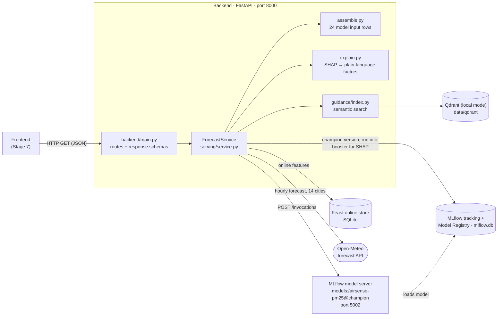
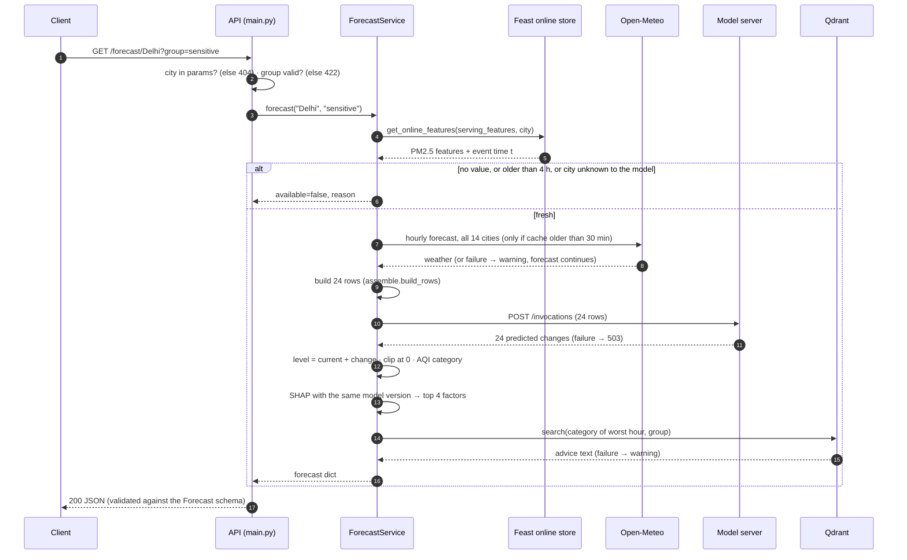

# AirSense — Low-Level Design (serving)

This document describes how the AirSense serving system is built: its components,
the API contract, the request flow, the model input contract, error handling,
configuration and tests. It covers the code in `model_server/`, `backend/`,
`src/airsense/serving/` and `src/airsense/guidance/`.

The data pipeline that produces the model and the features (ingestion, Spark
processing, Feast, training, gate, registry) is described in
`docs/data_sources.md` and `docs/features.md`; it appears here only where serving
reads its outputs.

---

## 1. Components



| Component | Code | Responsibility | Reads | Writes |
|---|---|---|---|---|
| Model server | `model_server/serve.sh` (`mlflow models serve`) | Serves the **champion** model over REST; nothing else | MLflow Registry (`mlflow.db`, `mlruns/`) | — |
| Backend API | `backend/main.py` | HTTP routes, request validation, response schemas, error → status code mapping, CORS | — | — |
| ForecastService | `src/airsense/serving/service.py` | One forecast end to end: freshness check, weather, input rows, model call, AQI, explanation, guidance | Feast online store, Open-Meteo, MLflow, Qdrant | weather snapshots `data/raw/live/openmeteo/` |
| Row builder | `src/airsense/serving/assemble.py` | Builds the 24 input rows exactly as training did | — | — |
| Explanations | `src/airsense/serving/explain.py` | Turns SHAP values into the top factors in plain words | — | — |
| Guidance index | `src/airsense/guidance/index.py`, `guidance_docs/` | Builds (DVC stage `guidance_index`) and searches the health-advice collection | `guidance_docs/*.md` | `data/qdrant/`, `data/interim/guidance_index.json` |

**Why two serving processes.** The model server is MLflow's standard way to serve a
registered model; it knows nothing about cities, weather or users. The backend owns
all application logic. A new model version therefore needs no backend code change,
and the model server can be scaled or replaced (Stage 8 containers) on its own.

**Why the backend also loads the model.** SHAP explanations need the LightGBM
booster itself (`pred_contrib=True`), which the REST interface does not expose. The
backend loads the **same registry version** the model server serves (resolved through
the `champion` alias at startup) and uses it only for explanations; forecasts always
come from the model server. `/health` reports if the two could differ (§6).

---

## 2. API contract

Base URL: `http://127.0.0.1:8000`. All endpoints are `GET`, return JSON, and are
documented interactively at `/docs` (OpenAPI, generated from the schemas in
`backend/main.py`).

### 2.1 Endpoints

| Endpoint | Parameters | Success | Errors |
|---|---|---|---|
| `GET /health` | — | 200: status of model server, feature store, champion version | — (problems are reported in the body, never as an error) |
| `GET /cities` | — | 200: latest PM2.5 for all 14 cities | — |
| `GET /forecast/{city}` | `city` (path, exact name, e.g. `Delhi`); `group` (query: `general` · `sensitive` · `outdoor_workers`, default `general`) | 200: forecast, or `available: false` with a reason | 404 unknown city · 422 invalid `group` · 503 model server unavailable |
| `GET /model` | — | 200: champion model and its metrics | — |
| `GET /guidance` | `category` (query, required: `Good` · `Satisfactory` · `Moderate` · `Poor` · `Very Poor` · `Severe`); `group` (as above) | 200: best-matching advice | 422 invalid value · 503 guidance index unavailable |

### 2.2 Status codes

| Code | Meaning | Example |
|---|---|---|
| 200 | Request handled. For `/forecast` this includes "no forecast possible" (`available: false`), because that is a valid answer about the data, not a failure of the service | data older than 4 h |
| 404 | The city is not one of the 14 configured cities | `/forecast/Atlantis` |
| 422 | A parameter has a value outside its allowed set (checked by FastAPI from the schema) | `group=everyone` |
| 503 | A dependency is down; the client may retry later. The cause is logged, not sent | model server stopped |
| 500 | Not expected; any unhandled error. Covered by tests for every known failure (§8) | — |

### 2.3 `GET /forecast/{city}` response

| Field | Type | Unit / values | Meaning |
|---|---|---|---|
| `city`, `region` | string | — | as in `params.yaml → data.cities` |
| `generated_at_utc` | string (ISO 8601) | UTC | when the answer was computed |
| `available` | bool | — | `false` → no forecast; see `reason` |
| `reason` | string or null | — | why no forecast (only when `available` is false) |
| `model` | object | `name`, `version`, `target_mode` | the champion that produced the forecast |
| `current.pm25_24h` | float | µg/m³ | latest 24-hour average PM2.5 (city mean of stations) |
| `current.aqi_category` | string | CPCB category | of the current value |
| `current.time_utc`, `current.time_ist` | string | UTC ISO / `"Fri 23 Oct 16:00"` IST | the hour the current value describes |
| `current.age_hours` | float | hours | `generated_at` − that hour |
| `current.stations` | int | — | stations behind the city value |
| `forecast[]` | list of 24 | — | one entry per horizon |
| `forecast[].horizon` | int | 1 … 24 | hours ahead of `current.time_utc` |
| `forecast[].time_utc`, `.time_ist` | string | — | the hour forecast |
| `forecast[].pm25` | float | µg/m³, ≥ 0 | forecast 24-hour average PM2.5 |
| `forecast[].aqi_category` | string | CPCB category | of the forecast value |
| `worst_next_24h` | object | `time_ist`, `pm25`, `aqi_category` | the highest forecast hour |
| `explanation[]` | list (≤ 4) | `factor`, `effect_ug_m3`, `direction` (`raises` · `lowers`) | inputs that moved this forecast most (§3.6) |
| `guidance` | object or null | `category`, `pm25_range`, `group`, `text`, `sources[]`, `score` | advice for the worst category and the chosen group |
| `warnings[]` | list of strings | — | anything degraded (§6) |
| `model_latency_ms` | float | ms | time of the model-server call |

CPCB AQI categories for 24-hour PM2.5 (µg/m³): Good 0–30, Satisfactory 31–60,
Moderate 61–90, Poor 91–120, Very Poor 121–250, Severe > 250.

Example (shortened; real response, 23 Oct 2026):

```json
{
  "city": "Delhi", "region": "North", "available": true,
  "model": {"name": "airsense-pm25", "version": 1, "target_mode": "change"},
  "current": {"pm25_24h": 221.8, "aqi_category": "Very Poor",
              "time_utc": "2026-10-23T10:30:00+00:00", "time_ist": "Fri 23 Oct 16:00",
              "age_hours": 2.7, "stations": 56},
  "forecast": [
    {"horizon": 1, "time_utc": "2026-10-23T11:30:00+00:00", "time_ist": "Fri 23 Oct 17:00",
     "pm25": 223.4, "aqi_category": "Very Poor"},
    "... 23 more ..."
  ],
  "worst_next_24h": {"time_ist": "Sat 24 Oct 05:00", "pm25": 231.2, "aqi_category": "Very Poor"},
  "explanation": [
    {"factor": "change over the last 1h", "effect_ug_m3": 8.5, "direction": "raises"},
    {"factor": "city", "effect_ug_m3": 3.3, "direction": "raises"},
    {"factor": "PM2.5 12h ago", "effect_ug_m3": -2.7, "direction": "lowers"},
    {"factor": "PM2.5 6h ago", "effect_ug_m3": -2.3, "direction": "lowers"}
  ],
  "guidance": {"category": "Very Poor", "group": "sensitive", "pm25_range": "121-250 µg/m³ (24-hour average)",
               "text": "Children, older adults and people with asthma, heart or lung disease should stay indoors ...",
               "sources": ["CPCB, National Air Quality Index (2014) ...", "WHO, Global Air Quality Guidelines (2021) ..."],
               "score": 0.724},
  "warnings": ["PM2.5 history missing for: pm25_lag_48h"],
  "model_latency_ms": 11.3
}
```

When no forecast is possible:

```json
{"city": "Delhi", "region": "North", "available": false,
 "reason": "latest PM2.5 value is 6.8 h old (limit 4 h)",
 "model": {"name": "airsense-pm25", "version": 1, "target_mode": "change"},
 "current": null, "forecast": [], "explanation": [], "guidance": null, "warnings": []}
```

### 2.4 Other responses

- **`/health`** — `{"status": "ok" | "degraded", "checks": {"model_server": bool, "feature_store": bool, "champion_up_to_date": bool}, "model_version": …, "registry_champion": …}`; `degraded` if any check is false.
- **`/cities`** — list of `{city, region, pm25_24h, aqi_category, age_hours}`; values are `null` for a city without data.
- **`/model`** — `{name, version, run_id, target_mode, val_mae, test_mae, test_skill, trained_at, training_data_md5}` from the MLflow run of the champion.
- **`/guidance`** — list (one item) of the guidance object described above.

---

## 3. Forecast request flow



### 3.1 Live PM2.5 features

`FeatureStore.get_online_features(features=serving_features, entity_rows=[{"city": …}])`
returns the newest row of the `pm_live` feature view for the city, with its event
time (`include_event_timestamps=True`). The online store is filled by the DVC stage
`feast_online` (materialization of the last 7 days of live features; newest row per
city wins).

**Freshness rule.** `age = now − t`. A forecast is made only if a current value
exists and `age ≤ validation.processed.max_live_age_hours` (4 h). The normal age is
about 2–3 h: the hour label is the start of the hour, CPCB publishes about an hour
later, and collection runs every 30 minutes. Feast's own TTL is not used for this
because the SQLite online store does not apply it on reads.

### 3.2 Weather

- One Open-Meteo **forecast** request covers all 14 cities (`past_days: 2`,
  `forecast_days: 3`): the past hours give the weather "now" and the 24-hour rain sum,
  the future hours cover every target hour up to *t* + 24.
- The response goes through the **same `weather_features()`** as training (wind
  direction as sin/cos, 24-hour rain sum, relabelling by −30 min so that weather at
  11:00 UTC describes the PM2.5 hour labelled 10:30).
- The table is cached for `serving.weather_cache_minutes` (30). After a failed call
  the service waits `serving.weather_retry_minutes` (5) before trying again, so a
  provider outage costs one slow request (the client's 3 attempts, about 30 s), not
  one per request.
- Every successful fetch is saved to `data/raw/live/openmeteo/<date>/<HHMM>.csv`.
  These snapshots are the input for the forecast-versus-archive weather comparison
  in Stage 10 (training used archive weather, serving uses forecasts).

### 3.3 Model input rows

`assemble.build_rows()` creates one row per horizon *h* = 1 … 24 with the model's
columns in the model's order (§4).

### 3.4 Prediction

The rows are sent as pandas "split" JSON to `POST /invocations` (missing values as
`null`). The champion was trained in **change** mode: it predicts
`pm25_24h(t + h) − pm25_24h(t)`, so the service adds the current value back
(`to_level`, the same function training used for evaluation). Forecasts below 0 are
set to 0 with a warning; a non-finite forecast makes the answer `available: false`.

### 3.5 AQI category

Each value gets its CPCB category (`aqi_name`, same band edges as training's AQI
accuracy metric). `worst_next_24h` is the hour with the highest forecast; its
category selects the guidance.

### 3.6 Explanation

`booster.predict(rows, pred_contrib=True)` gives TreeSHAP values per row and feature
(the last column, the bias, is dropped). Values are averaged over the 24 rows,
features with one meaning are merged (wind direction sin + cos), and the 4 with the
largest absolute mean are returned with a plain-language name
(`pm25_lag_12h` → "PM2.5 12h ago", `wind_speed_10m_target` → "wind speed expected").
In change mode a factor's effect is its contribution to the predicted **change** from
the current value, in µg/m³.

### 3.7 Health guidance

`guidance_docs/` holds six files, one per AQI category, each with three sections
(`general`, `sensitive`, `outdoor_workers`) written in our own words from the CPCB
National AQI health statements (2014) and WHO public advice (2021); sources are
stored with every text. The DVC stage `guidance_index` embeds the 18 texts with
`sentence-transformers/all-MiniLM-L6-v2` (384 dimensions, normalised) and stores them
in a Qdrant collection (cosine distance) with category, group, text and sources as
payload.

A search filters on the **category** (exact match) and ranks by similarity to a
query describing the **group**, so the category is always right and the group is
matched by meaning. The index build checks itself: the query "Poor, sensitive" must
return the `sensitive` text, or the stage fails.

---

## 4. Model input contract

The model has **40 inputs**. Their names and order are read from the model at
startup (`booster.feature_name()`); the backend never hard-codes them.

| Group | Features | Source at serving time |
|---|---|---|
| Current PM2.5 | `pm25_24h`, `n_stations_24h` | Feast online store |
| History | `pm25_lag_{1,3,6,12,24,48,72}h`, `pm25_change_{1,6,24}h`, `pm25_mean_72h`, `pm25_max_72h` | Feast online store |
| Weather now | `temperature_2m_now`, `relative_humidity_2m_now`, `precipitation_now`, `wind_speed_10m_now`, `surface_pressure_now`, `cloud_cover_now`, `wind_dir_sin_now`, `wind_dir_cos_now`, `rain_24h_now` | Open-Meteo forecast at *t* |
| Weather at target | the same 9 with suffix `_target` | Open-Meteo forecast at *t* + *h* |
| Horizon | `horizon` | 1 … 24 |
| Calendar of the target hour (Indian time) | `hour`, `day_of_week`, `month`, `is_weekend`, `is_festival` | `calendar_features()` |
| Location | `city`, `region` | fixed integer codes from the run's `category_codes.json` |

**Missing values.** Training kept gaps as NaN (no imputation), and LightGBM learned
how to treat them. Serving does the same: a feature Feast returns as empty (`None`)
and any hour without weather become NaN. They are listed in `warnings` so the user
can see what was missing. All columns are sent as float64.

**Why training and serving cannot drift apart.**
- The same functions build the inputs: `weather_features()`, `calendar_features()`
  and `to_level()` are imported from the training code, not re-implemented.
- The category codes come from the same MLflow run as the model.
- Unit test `test_serving_rows_equal_training_rows` builds the rows for one forecast
  time through the training path (`build_training.expand_horizon` +
  `encode_categories`) and through the serving path (`build_rows`) from identical
  inputs, and requires the two tables to be equal.

**Known, accepted difference.** Training used Open-Meteo **archive** weather;
serving uses the **forecast**. Forecast errors are therefore new to the model. The
saved forecast snapshots (§3.2) allow measuring this gap in Stage 10.

---

## 5. Startup and model versions

At startup (`lifespan` in `main.py`) the backend creates one `ForecastService`, which:

1. reads `params.yaml`;
2. opens the Feast feature store (`feature_repo/`);
3. resolves `models:/airsense-pm25@champion` to a version number in the MLflow
   Registry, reads its run (metrics, `target_mode`, training-data checksum) and loads
   that version's booster and `category_codes.json`.

The embedding model and Qdrant are opened on the first guidance request (behind a
lock, because local Qdrant allows a single open client per folder).

**A new champion** (promoted by the `register` stage) is picked up by restarting the
model server and then the backend. Until both are restarted, `/health` shows
`champion_up_to_date: false` (the registry alias points to a version other than the
one loaded). In Stage 9 the restart becomes part of the automated pipeline.

---

## 6. Error handling and degraded operation

| Situation | What the user gets | Where handled |
|---|---|---|
| Unknown city | 404 `Unknown city '…'` | `main.py` |
| Invalid `group` / `category` | 422 with the allowed values | FastAPI schema |
| No current PM2.5 value (station outage, empty or NaN) | 200, `available: false`, "no current PM2.5 value for this city" | `ForecastService.forecast` |
| Current value older than 4 h (collection stopped, online store not refreshed) | 200, `available: false`, "latest PM2.5 value is X h old (limit 4 h)" | same |
| City configured but not known to the model | 200, `available: false`, "city not known to the model" | same |
| Some PM2.5 history empty (collection gap) | forecast made; warning "PM2.5 history missing for: …" | same |
| Weather provider down or slow | forecast made with the last cached weather, or without weather (NaN); warning "weather forecast unavailable (…)"; retried after 5 min | `weather_table` |
| Some weather hours missing | forecast made; warning "weather missing for N of 25 hours" | same |
| Model server down, slow (> 10 s) or answering nonsense | 503 "Model server unavailable, try again later"; cause logged | `ModelServerClient` → `main.py` |
| Model returns a non-finite value | 200, `available: false`, "model gave no valid forecast" | `ForecastService.forecast` |
| Forecast below 0 | values set to 0; warning | same |
| Guidance index locked (index rebuild running) or embedding model missing | forecast made with `guidance: null` and a warning; `/guidance` → 503 | `forecast`, `main.py` |
| Feature store unreadable | `/health` reports `feature_store: false` | `health` |

Design rule: the user always gets either a forecast or a clear reason. Problems with
optional parts (weather, guidance) reduce quality and are reported in `warnings`;
only the model server is essential, and its absence is a 503 that a client can retry.

---

## 7. Configuration and operations

| Setting | Value | Purpose |
|---|---|---|
| `serving.model_server_url` | `http://127.0.0.1:5002` | where the backend finds the model server (5001 is used by another local service) |
| `serving.weather_cache_minutes` | 30 | one Open-Meteo call per 30 min for all cities |
| `serving.weather_retry_minutes` | 5 | wait after a failed weather call |
| `serving.weather_past_days` / `weather_forecast_days` | 2 / 3 | hours needed for "now", 24-hour rain and *t* + 24 |
| `serving.top_factors` | 4 | factors in the explanation |
| `guidance.docs_dir` | `guidance_docs` | source texts |
| `guidance.qdrant_path` | `data/qdrant` | local Qdrant folder (git-ignored, rebuilt by DVC) |
| `guidance.collection` | `guidance` | collection name |
| `guidance.embedding_model` | `sentence-transformers/all-MiniLM-L6-v2` | text embedding model |
| `validation.processed.max_live_age_hours` | 4 | freshness limit (shared with data validation) |

Running locally (from the project root, virtual environment active):

```bash
dvc repro guidance_index                        # once, and after editing guidance_docs/
dvc repro feast_online                          # refresh live features (Stage 9: Airflow)
bash model_server/serve.sh                      # terminal 1: model server on port 5002
uvicorn main:app --app-dir backend --port 8000  # terminal 2: backend on port 8000
```

`MODEL_SERVER_PORT` overrides the model server's port; `serving.model_server_url`
must then be changed to match. Rebuilding the guidance index requires the backend to
be stopped (single-client rule of local Qdrant).

---

## 8. Performance

Measured on the development laptop (CPU only, 12 threads):

| Step | Time |
|---|---|
| Model-server call, 24 rows | 11–75 ms (first call after start is the slowest) |
| Feast online read | < 1 ms (median 0.5 ms) |
| Open-Meteo, 14 cities | one HTTP request, at most once per 30 min |
| Guidance search | embedding one short query + one Qdrant lookup; the first request also loads the embedding model (a few seconds) |
| Building the guidance index (18 texts) | 59 s on the first run, almost all of it the one-time 90 MB model download |

Memory: the backend holds one LightGBM booster, the weather table (14 cities × 120
hours) and the small embedding model; the model server holds one booster.

---

## 9. Tests

| Test file | What it checks |
|---|---|
| `tests/unit/test_serving.py` | serving rows equal training rows for the same inputs; missing weather counted and left NaN; empty Feast features become NaN; AQI category edges; factor names and SHAP aggregation |
| `tests/unit/test_service.py` | `ForecastService.forecast` with fake inputs: normal forecast (current + change), stale / missing / NaN current value, city unknown to the model, missing history reported, negative forecast clipped, model server down raises the error the API turns into 503, guidance failure keeps the forecast |
| `tests/unit/test_guidance.py` | all 6 categories × 3 groups parsed with sources; malformed file rejected; search returns the right category and group (local Qdrant in a temporary folder, deterministic test embedder) |
| `tests/unit/test_api.py` | every endpoint and response schema; 404 for an unknown city; 422 for invalid values; `available: false` carries a reason; dependency failures give 503, not 500 |

The tests need no network, no running servers and no model download; they run in the
pre-commit hook with the rest of the quick suite.

End-to-end check on real data (manual, after starting both servers):
`/health` all true; `/forecast/Delhi` returns 24 hours, factors and guidance;
stopping the model server turns `/forecast` into 503.

---

## 10. Planned changes

| Stage | Change |
|---|---|
| 7 | Frontend calls this API (CORS already allows `GET` from any origin) |
| 8 | Model server, backend and Qdrant in separate containers (Docker Compose); Qdrant client switches from a local folder to `QdrantClient(url=…)`; Feast online store to Redis |
| 9 | Airflow refreshes the online store after each collection run and restarts the servers when a new champion is registered |
| 10 | Request and latency metrics from the backend; live-versus-forecast error tracking from the saved weather snapshots and later actuals |
