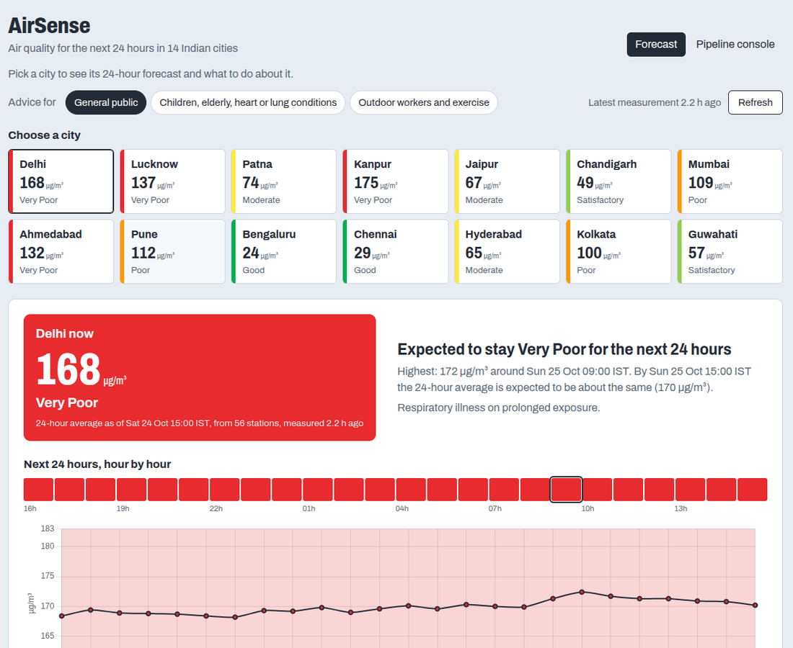
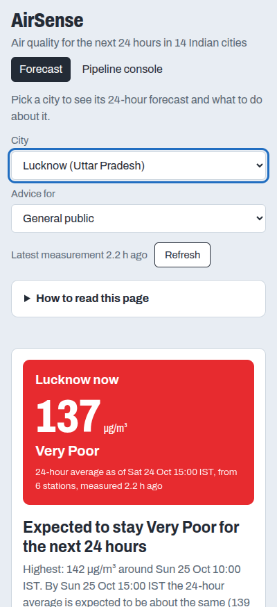
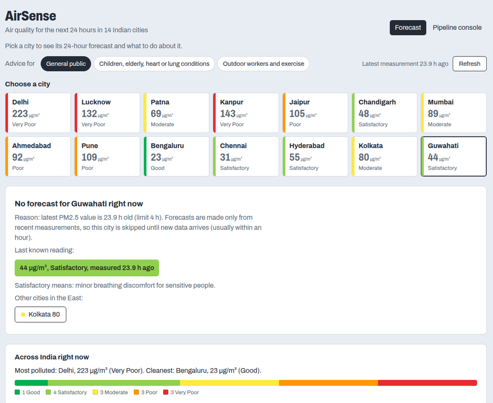

# AirSense — User Manual

AirSense shows the air quality in 14 Indian cities for the next 24 hours, and what to do about it. This manual is for anyone who uses the website; no technical knowledge is needed. The last section is for the people who run the system.

*Draft, October 2026. Screenshots taken from the running system on 24 October 2026.*

---

## 1. What AirSense tells you

For each city AirSense shows:

- **the air quality now**: the amount of fine dust (PM2.5) in the air, averaged over the last 24 hours, and its category on India's official Air Quality Index (AQI);
- **the forecast**: the expected value for each of the next 24 hours;
- **advice**: what to do, for the general public, for sensitive people, or for people who work or exercise outdoors;
- **why**: the main reasons the forecast goes up or down.

**What is PM2.5?** Particles in the air smaller than 2.5 micrometres, about thirty times thinner than a human hair. They come from vehicles, industry, construction dust, and burning of crops, waste and fuel. They are small enough to reach deep into the lungs, which is why they matter for health. Values are given in micrograms per cubic metre (µg/m³).

**Why a 24-hour average?** India's official AQI for PM2.5 uses the average over 24 hours, and the government's live measurements are reported the same way. AirSense uses the same quantity, so its numbers can be compared with official reports.

### AQI categories (CPCB, for 24-hour PM2.5)

| Category | PM2.5 (µg/m³) | Possible health impact |
|---|---|---|
| Good | 0–30 | Minimal impact |
| Satisfactory | 31–60 | Minor breathing discomfort for sensitive people |
| Moderate | 61–90 | Breathing discomfort for people with lung or heart disease, children and older adults |
| Poor | 91–120 | Breathing discomfort for most people on prolonged exposure |
| Very Poor | 121–250 | Respiratory illness on prolonged exposure |
| Severe | above 250 | Affects healthy people; serious for those with existing disease |

The colours on the website are the official CPCB colours, and the category name is always written next to the colour.

---

## 2. Opening AirSense

Open the AirSense address in any modern browser (Chrome, Firefox, Edge, Safari), on a computer or a phone. On the computer where AirSense runs, the address is **http://localhost:8080**.

There are two pages, linked at the top right:

- **Forecast**: for everyone (sections 3–6);
- **Pipeline console**: for the people who run the system (section 8).

---

## 3. The Forecast page on a computer

### 3.1 Choose who the advice is for

Under the title, **Advice for** offers three choices:

- **General public**
- **Children, elderly, heart or lung conditions**: stricter advice for sensitive people;
- **Outdoor workers and exercise**: advice for people who spend long periods outside.

The choice changes only the advice text; the forecast is the same for everyone.

### 3.2 Choose a city

The 14 city tiles show each city's current 24-hour average and its category. The coloured band on the left of a tile is the AQI colour. A tile with **"No recent data"** has no measurement from the last few hours.

Click a tile to see that city's details below. The selected tile has a dark outline.

### 3.3 Read the details

1. **The coloured box** ("Delhi now"): the current 24-hour average, its category, the hour it describes, the number of measuring stations, and how long ago it was measured (normally about 2–3 hours, because official data is published with a delay).
2. **The outlook** next to it, for example *"Expected to stay Very Poor for the next 24 hours"*, with the highest expected value and when it happens.
3. **Next 24 hours, hour by hour**: one coloured cell per hour. The hour with the highest value has a dark outline. Hover over a cell to see its value.
4. **The line chart**: the same forecast as numbers; the background colour shows the AQI band. Hover over a point to see its value and category.
5. **What to do**: advice for the group chosen in 3.1, with its sources (CPCB and the World Health Organization).
6. **Why this forecast**: the four inputs that changed the forecast most. A red bar to the right means the input **raises** the forecast; a green bar to the left means it **lowers** it. The number is the effect in µg/m³.
7. **Notes on this forecast** (yellow box, only when needed): some input data was missing, for example a past hour that was not measured. The forecast is still made but may be less accurate.

**Why is the line so flat?** Each new hour replaces only one of the 24 hours in the average, so a 24-hour average can only change slowly. A flat line does not mean the forecast is not working.

### 3.4 Across India right now

Below the details: the most polluted and the cleanest city, and a bar showing how many cities are in each category.

### 3.5 Refreshing

The page updates itself every 10 minutes. **Latest measurement … ago** (top right) shows how recent the data is; **Refresh** updates it immediately.

---

## 4. The Forecast page on a phone

On a phone the city tiles are replaced by two menus:

- **City**: choose a city; the state is shown in brackets, for example *Lucknow (Uttar Pradesh)*. Values are for the city itself (the average of its own stations), not for the whole state.
- **Advice for**: the same three choices as on a computer.

The details appear directly below, in the same order as on a computer. **Across India right now** at the bottom also lists all 14 cities from most to least polluted; tap a city to open it.

---

## 5. When there is no forecast

AirSense only forecasts from **recent** measurements (at most 4 hours old). If a city's latest measurement is older, or missing, the page says **"No forecast for … right now"** and gives:

- the reason (for example, *latest PM2.5 value is 23.9 h old*);
- the last known reading and what its category means;
- buttons for other cities in the same region.

This usually resolves itself when new data arrives (normally within an hour). A forecast can also be missing when the weather forecast is not available for all of the next 24 hours.

### Other messages

| Message | Meaning | What to do |
|---|---|---|
| *Loading the forecast for …* | The forecast is being calculated (usually under a second; the first request after a restart can take a few seconds). | Wait. |
| *Notes: live weather forecast unavailable; using the forecast fetched …* | The weather service could not be reached, so a weather forecast saved a few hours earlier is used. | Nothing; the forecast is still valid but may be slightly less accurate. |
| *Could not load the forecast … Model server unavailable* | The forecasting model is not running. | Try again later; operators see this on the Pipeline console. |
| Red bar at the top: *The forecast service … cannot be reached* | The website cannot reach the AirSense service. | Check your connection and use Refresh; if it persists, contact the operator. |

---

## 6. Good to know

- **Forecasts are estimates.** On test data the average error was about 7 µg/m³ for the 24-hour average, with the right AQI category in about 83% of cases. Always follow official health advisories.
- **Measurements** come from the Central Pollution Control Board (CPCB) stations, through the government's open data portal (data.gov.in). **Weather** comes from Open-Meteo.com.
- **Cities covered:** Delhi, Lucknow, Patna, Kanpur, Jaipur, Chandigarh (North); Mumbai, Ahmedabad, Pune (West); Bengaluru, Chennai, Hyderabad (South); Kolkata, Guwahati (East).
- **Privacy:** AirSense does not ask for, store or send any personal information. The settings you choose are not saved.

---

## 7. Frequently asked questions

**The value for my city differs from another app.** Other apps may show hourly values, a different set of stations, or another country's AQI scale. AirSense uses CPCB stations and the 24-hour average used by India's official AQI.

**Why does the forecast start one or two hours in the past?** Official measurements are published with a delay of about an hour, so "now" in AirSense is the latest published hour, and the forecast continues from there.

**What does "No recent data" on a tile mean?** The city's stations have not reported for several hours (station or network outage). Check again later.

**Does AirSense work offline?** No; it needs the AirSense service, which needs the internet for live measurements and weather.

---

## 8. For operators: the Pipeline console

The **Pipeline console** shows whether the system behind the forecasts is healthy. It reads only; it cannot start or change anything. It updates every minute.

| Section | What it answers | What to do when it is not green |
|---|---|---|
| **Pipeline steps** (summary) | Are all steps up to date? | "*n* need a re-run": run `dvc repro` (from Stage 9, the scheduler does this). |
| **Live data collection** (summary and timeline) | Are new measurements arriving every 30 minutes? Pink cells are missed half-hours. | Check that the computer was on and connected; check the collector log. |
| **Live model** | Which model version serves forecasts, and how accurate it was on test data. | — |
| **Quality gate** | Did the live model pass all 5 automatic checks before it was allowed to serve? | A failed check means a new model was not promoted; see the gate report. |
| **Pipeline graph** | All 14 steps and which step feeds which. Green = up to date, amber = inputs changed (needs a re-run), grey = runs on every pipeline run. Select a step to see its latest report and the reason it changed. | — |
| **Processing speed** | Rows per second of each data step (latest run). | A large drop compared with earlier runs points to a problem. |
| **All steps** | The same steps as a table, with last run times. | — |
| **Recent warnings and errors** | The latest problems written by the collector (for example temporary timeouts of the government data portal). | Occasional warnings are normal (retries succeed); repeated errors need attention. |

Technical details of the service (API, error handling, configuration) are in `docs/lld.md`.
