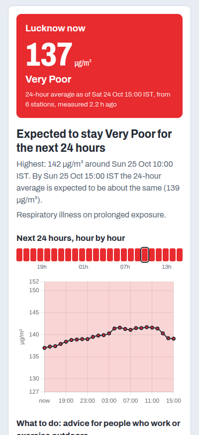
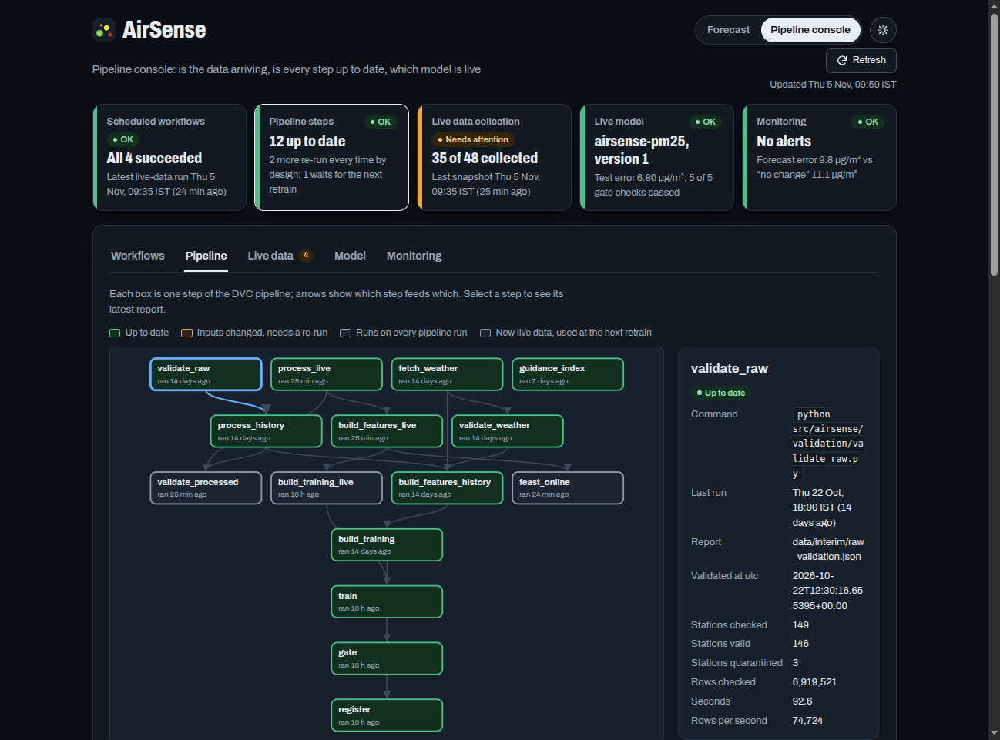
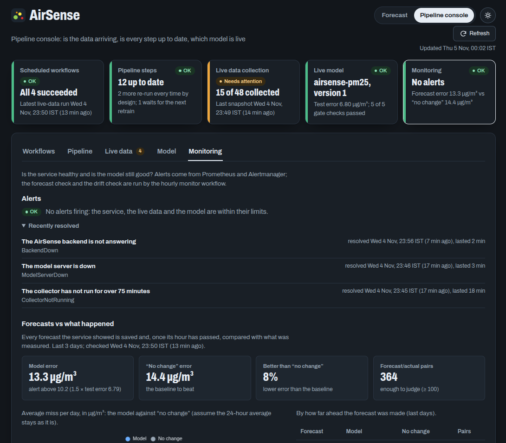

# AirSense — User Manual

AirSense shows the air quality in 14 Indian cities for the next 24 hours, and what to do about it. This manual is for anyone who uses the website; no technical knowledge is needed. The last section is for the people who run the system.

*Version 1.0, November 2026. Screenshots taken from the running system on 5 November 2026; the values on your screen will differ.*

---

## 1. What AirSense tells you

For each city AirSense shows:

- **the air quality now**: the amount of fine dust (PM2.5) in the air, averaged over the last 24 hours, and its category on India's official Air Quality Index (AQI);
- **the forecast**: the expected value for each of the next 24 hours;
- **advice**: what to do, for the general public, for sensitive people, or for people who work or exercise outdoors;
- **why**: the main reasons the forecast goes up or down.

**What is PM2.5?** Particles in the air smaller than 2.5 micrometres, about thirty times thinner than a human hair. They come from vehicles, industry, construction dust, and burning of crops, waste and fuel. They are small enough to reach deep into the lungs, which is why they matter for health. Values are given in micrograms per cubic metre (µg/m³).

**Why a 24-hour average?** India's official AQI for PM2.5 uses the average over 24 hours, and the government's live measurements are reported the same way. AirSense uses the same quantity, so its numbers can be compared with official reports.

### AQI categories (CPCB, for 24-hour PM2.5)

| Category | PM2.5 (µg/m³) | Possible health impact |
|---|---|---|
| Good | 0–30 | Minimal impact |
| Satisfactory | 31–60 | Minor breathing discomfort for sensitive people |
| Moderate | 61–90 | Breathing discomfort for people with lung or heart disease, children and older adults |
| Poor | 91–120 | Breathing discomfort for most people on prolonged exposure |
| Very Poor | 121–250 | Respiratory illness on prolonged exposure |
| Severe | above 250 | Affects healthy people; serious for those with existing disease |

The colours on the website are the official CPCB colours, and the category name is always written next to the colour.

---

## 2. Opening AirSense

Open the AirSense address in any modern browser (Chrome, Firefox, Edge, Safari), on a computer or a phone. On the computer where AirSense runs, the address is **http://localhost:8080**.

There are two pages, linked at the top right (on a phone, behind the menu button ☰):

- **Forecast**: for everyone (sections 3–6);
- **Pipeline console**: for the people who run the system (section 8).

The moon / sun button next to them switches between a light and a dark theme. The first time, AirSense follows your computer's or phone's setting; after that, your browser remembers your choice.

All times are Indian Standard Time, written the same way everywhere: *Mon 2 Nov, 11:00 IST*, often followed by how long ago it was, for example *(2 h ago)*.

---

## 3. The Forecast page on a computer

### 3.1 Choose a city

The 14 city tiles show each city's current 24-hour average PM2.5 (in µg/m³) and its category, **most polluted first**. The coloured band on the left of a tile is the AQI colour. A tile with **"No recent data"** has no measurement from the last few hours. Hover over a tile to see the state and when it was measured.

Click a tile to see that city's details below. The selected tile has a dark outline and a light tint of its colour.

### 3.2 Read the details

1. **The coloured box**: the city's current 24-hour average, its category, a scale showing where the value sits among the six AQI categories, and the hour it describes.
2. **The outlook** next to it, for example *"Expected to stay Very Poor for the next 24 hours"*, with three figures: the **highest** and **lowest** expected values and when they happen, and the **change over the 24 hours** (in µg/m³ and %). Below them: where the 24-hour average is heading by the last forecast hour, the **health effect** of the worst category expected (*"At Very Poor: …"* when the category stays the same, *"If it reaches Severe: …"* when it gets worse), and how many stations the value comes from and how long ago it was measured (normally about 2–3 hours, because official data is published with a delay).
3. **Next 24 hours, hour by hour**: a chart with a row of coloured boxes along the top, **one box directly above each hour's point**, in that hour's AQI colour. The legend above the chart explains the symbols: the first point is a **diamond ◆** (with an outlined box above it): the latest **measured** value; the other points are **circles ●**, the **forecast** for each of the next 24 hours, each in its AQI colour. The **highest** forecast hour has an orange ring and the label *Peak*, the **lowest** a blue ring and *Low* (the measured value is not counted). Times are written under the chart every 3 hours, starting with the measured hour; a dashed line marks midnight, with the new day's name above the boxes; the background colour shows the AQI band.
4. **Hover over a box or a point** (on a phone, tap; with the keyboard, select the chart and use the left and right arrow keys): the box and the point light up together and a small box shows the date and time, the value and category, and whether it is measured or forecast (with the change from the hour before).
5. Two tabs below the chart:
   - **What to do** (shown first): choose who the advice is for (**General public**; **Children, elderly, heart or lung conditions**: stricter advice for sensitive people; **Outdoor workers and exercise**: for people who spend long periods outside). The choice changes only the advice text; the forecast is the same for everyone. The sources (CPCB and the World Health Organization) are listed under the advice.
   - **Why this forecast**: the six inputs that changed the forecast most, and **all other factors combined** in the last row. An orange bar to the right means the input **raises** the forecast; a blue bar to the left means it **lowers** it. The number is the effect in µg/m³, averaged over the next 24 hours. An input whose reading is missing is not listed (its effect is part of "all other factors").
6. **Notes on this forecast** (yellow box, only when needed): some input data was missing, for example a past reading that was not measured. The forecast is still made but may be less accurate.

**Why is the line so flat?** Each new hour replaces only one of the 24 hours in the average, so a 24-hour average can only change slowly. A flat line does not mean the forecast is not working.

### 3.3 Across India right now

Below the details: the **most polluted** and **cleanest** city, and any city with no recent data. Below them, two tabs:

- **By city** (shown first): one bar per city in its AQI colour, most polluted first, with the category names along the top. Click a bar to open that city.
- **By category**: how many cities are in each category, with *No data* first (set apart by a dashed line), then Good to Severe; categories with no city show 0. Hover over a bar to see its cities; click it to switch to **By city** with only those cities highlighted (**Show all** clears it).

### 3.4 How to read this page

At the bottom, **How to read this page** opens a short explanation (left) and the table of AQI categories with their colours and health impacts (right).

### 3.5 Refreshing

The page updates itself every 10 minutes. **Refresh** (top right) updates it immediately; the line under it, **Latest measurement …**, shows how recent the data is.

---

## 4. The Forecast page on a phone

On a phone the city tiles are replaced by a **City** menu at the top, listing the cities from most to least polluted with their value and category (values are for the city itself, the average of its own stations, not for the whole state). The pages are behind the menu button ☰ at the top right.

The details appear directly below, in the same order as on a computer; the advice choices are in the **What to do** tab. In **Across India right now** at the bottom, tap a city's bar to open it; the category chart is below it.

---

## 5. When there is no forecast

*In this example the limit was lowered to 1 hour for a test; normally it is 4 hours.*

AirSense only forecasts from **recent** measurements (at most 4 hours old). If a city's latest measurement is older, or missing, the page says **"No forecast for … right now"** and gives:

- the reason (for example, *Latest PM2.5 value is 23.9 h old*);
- the last known reading and what its category means;
- buttons for other cities in the same region.

This usually resolves itself when new data arrives (normally within an hour). A forecast can also be missing when the weather forecast is not available for all of the next 24 hours.

### Other messages

| Message | Meaning | What to do |
|---|---|---|
| *Loading the forecast for …* | The forecast is being calculated (usually under a second; the first request after a restart can take a few seconds). | Wait. |
| *Notes: The live weather forecast is unavailable, so this forecast uses the weather forecast fetched …* | The weather service could not be reached, so a weather forecast saved a few hours earlier is used. | Nothing; the forecast is still valid but may be slightly less accurate. |
| *Could not load the forecast … Model server unavailable* | The forecasting model is not running. | Try again later; operators see this on the Pipeline console. |
| *Could not load the forecast … Live data store unavailable* (or red bar *Could not load the city list: Live data store unavailable*) | The store holding the latest measurements is not running. | Use Refresh in a moment; if it persists, contact the operator. |
| *Notes: Health advice is unavailable right now.* | The forecast is shown, but the advice texts cannot be looked up. | Nothing; the forecast is still valid. Advice returns when the service is back. |
| Red bar at the top: *Could not load the city list: The AirSense service (backend) is not running or not answering* (or *cannot be reached*) | The website cannot reach the AirSense service. | Check your connection and use Refresh; if it persists, contact the operator. |

---

## 6. Good to know

- **Forecasts are estimates.** On test data the average error was about 7 µg/m³ for the 24-hour average, with the right AQI category in about 83% of cases. Always follow official health advisories.
- **Measurements** come from the Central Pollution Control Board (CPCB) stations, through the government's open data portal (data.gov.in). **Weather** comes from Open-Meteo.com.
- **Cities covered:** Delhi, Lucknow, Patna, Kanpur, Jaipur, Chandigarh (North); Mumbai, Ahmedabad, Pune (West); Bengaluru, Chennai, Hyderabad (South); Kolkata, Guwahati (East).
- **Privacy:** AirSense does not ask for, store or send any personal information. Only your light or dark theme choice is remembered, in your own browser.

---

## 7. Frequently asked questions

**The value for my city differs from another app.** Other apps may show hourly values, a different set of stations, or another country's AQI scale. AirSense uses CPCB stations and the 24-hour average used by India's official AQI.

**Why does the forecast start one or two hours in the past?** Official measurements are published with a delay of about an hour, so "now" in AirSense is the latest published hour, and the forecast continues from there.

**What does "No recent data" on a tile mean?** The city's stations have not reported for several hours (station or network outage). Check again later.

**Does AirSense work offline?** No; it needs the AirSense service, which needs the internet for live measurements and weather.

---

## 8. For operators: the Pipeline console

The **Pipeline console** shows whether the system behind the forecasts is healthy. It reads only; it cannot start or change anything. It updates every minute. The scheduler (Airflow, at http://localhost:8081) runs the pipeline; the console shows what it did.

At the top, five **summary cards**, each with a status word (**OK**, **Needs attention**, **Problem**) as well as a colour. Clicking a card opens its tab below. A small number on a tab (for example on **Live data**) counts the things to look at there.

| Tab (and card) | What it answers | What to do when it is not OK |
|---|---|---|
| **Workflows** (Scheduled workflows) | Did the four automatic workflows run, and did they succeed? *airsense_live* (every 30 min: collect, process, refresh live data), *airsense_monitor* (hourly: check the forecasts against what was measured, check for drift, start a retrain if needed), *airsense_retrain* (Sundays, or when the monitor starts it: retrain and serve a better model), *airsense_housekeeping* (daily: back up data, clean up). **Source empty** (amber) means the CPCB feed had no data at that moment: a gap at the source, not a fault in AirSense. Each row shows the latest run, the **next run**, how long the run **took**, and the result. Below: **Recent warnings and errors** written by the collector. | **Failed**: open it in Airflow ("Open in Airflow"), click the red box, read *Logs*. **Overdue** ("No run for a while"): Airflow is not running (start it with `bash airflow/start.sh` and keep that terminal open) or the computer was asleep. Occasional collector warnings are normal (retries succeed); repeated errors need attention. |
| **Pipeline** (Pipeline steps) | All 15 steps and which step feeds which. Green = up to date, amber = inputs changed (needs a re-run), grey = runs on every pipeline run, or (*build_training_live*) new live data that the next retrain will use. Select a step (in the graph or the **All steps** table) to see its command, latest report and the reason it changed. **Processing speed**: rows per second of each data step in its latest run. On a phone the graph is hidden and the table is the list of steps. | "*n* need a re-run": normally fixed by the next scheduled run; to run now, Trigger the workflow in Airflow. A large drop in processing speed compared with earlier runs points to a problem. |
| **Live data** (Live data collection) | Are new measurements arriving every 30 minutes? Four figures (collected in the last 24 hours, number of gaps, last snapshot, all snapshots), then one box per half-hour: green = collected, pink = missing, outlined = not due yet. Hover over a box for its time. Gaps are listed with their times; a gap that is still going on says *still missing*. | Check that the computer was on and connected and that Airflow is running; check the collector log. |
| **Model** (Live model) | Which model version serves forecasts, how accurate it was on test data (compared with "no change", i.e. assuming the 24-hour average stays as it is), and the **quality gate**: the 5 automatic checks it passed before it was allowed to serve, in plain words, with a bar showing value against limit where it applies. | A failed check means a new model was not promoted; see the gate report. |
| **Monitoring** (Monitoring) | Is anything wrong right now, and is the model still good? **Alerts** firing now (critical first, each with what to check) and *Recently resolved* ones with how long they lasted; **Forecasts vs what happened**: the average miss of the model and of "no change" over the last 3 days, per day and by how far ahead; **drift**: whether today's inputs (PM2.5, weather) still look like the training data; **automatic retraining**: the latest decision and why, when one was last started and when the next is possible; four live panels from Grafana (on the laptop only) and links to Grafana, Prometheus and Alertmanager. | Follow the alert's description; the table below says what each alert means. A high forecast error or drift starts a retrain by itself (at most every 3 days); the new model serves only if it passes the gate and beats the current one. |

### 8.1 When an alert fires

Alerts appear on the Monitoring tab about 2–3 minutes after a problem starts (short
blips never become alerts) and move to *Recently resolved* within about 5 minutes after
it ends.

| Alert | Meaning | What to do |
|---|---|---|
| The AirSense backend is not answering (critical) | the web pages cannot show forecasts or this console | `docker compose ps`; `docker compose logs backend --tail 80`; `docker compose start backend` |
| The model server is down (critical) | no forecasts can be made; city values still show | `docker compose logs model-server --tail 80`; `docker compose start model-server` |
| The live data store (Redis) cannot be read (critical) | forecasts and the city list fail | `docker compose ps redis`; `docker compose start redis` |
| The served model is not the registry's champion | a better model was registered but is not being served | `docker compose restart model-server backend` (the retrain workflow normally does this) |
| More than 5 % of API requests fail / Forecasts are slow | a dependency is struggling or the laptop is overloaded | check the other alerts and `docker compose logs backend`; close heavy programs |
| No city has data newer than 4 hours | no forecasts can be made | check that Airflow runs and the live workflow succeeds |
| The collector has not run for over 75 minutes | Airflow stopped or the laptop was asleep | start Airflow with `bash airflow/start.sh` and keep that terminal open |
| The CPCB feed has returned no data for over an hour | a gap at the source | nothing to fix; collection resumes when CPCB publishes again |
| The collector fails | network or API error for over 35 minutes | see `logs/collector.log` and the live workflow in Airflow; check the internet connection |
| Less than 5 GB free on the laptop's disk | rebuilds and container starts may fail | `df -h /`; `docker builder prune -f`; delete old files you no longer need |
| Forecasts are much worse than expected | over 3 days the error is above 1.5 × the test error and worse than "no change" | a retrain is started automatically; see the Model tab for its result |
| Live inputs differ from the training data | drift above 0.3 for at least one input | as above; the drift bars show which input changed |

### 8.2 If a retrain step fails after its work is done

If a step of *airsense_retrain* (for example *train*) fails at the very end although its
work finished (its log shows the results), it can be recovered without running it
again: `dvc commit -f train` in the project folder, then in Airflow mark the task as
*Success* (✓ / ✗ button, without "Downstream") and *Clear* the next task with
"Downstream" ticked. The retrain steps log in full, so the reason is at the end of the
step's log.

Technical details of the service (API, error handling, monitoring, configuration) are
in `docs/lld.md`; how monitoring works in `docs/architecture.md` §6.
